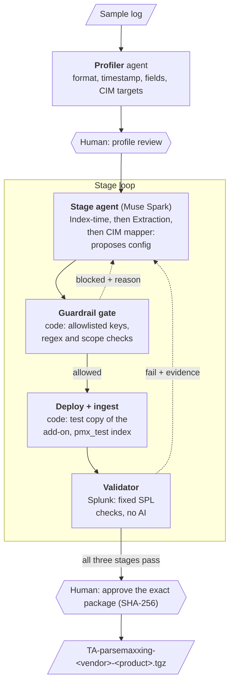
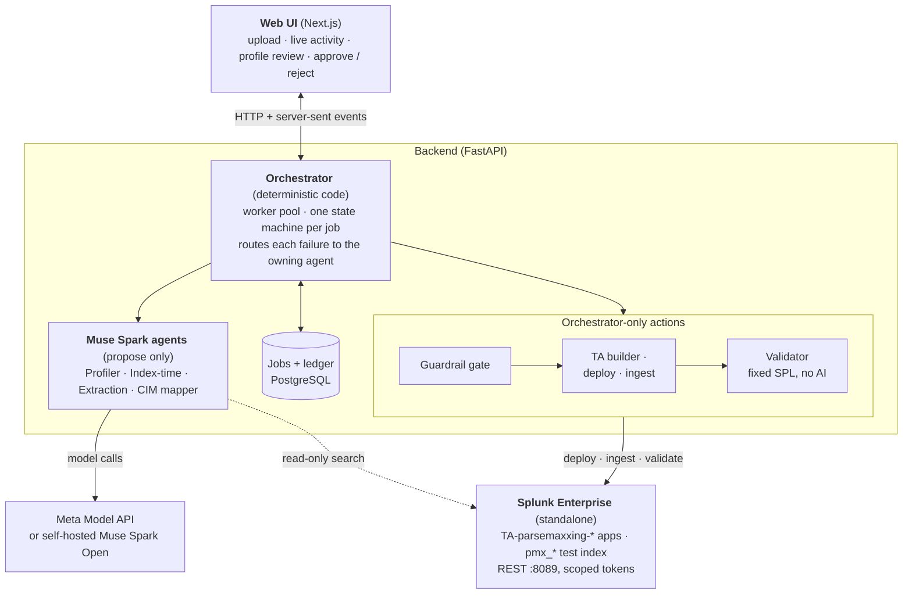
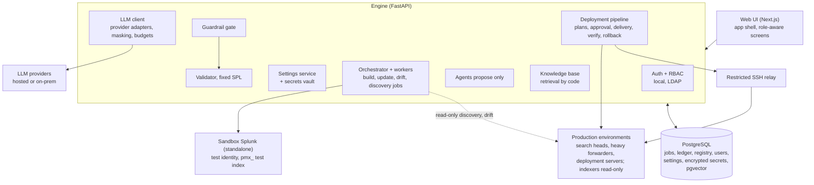

# Parsemaxxing

**Start parsemaxxing your logs.** · [parsemaxxing.com](https://parsemaxxing.com)

From raw sample logs to a tested, CIM-compliant Splunk add-on, verified by Splunk rather than by the model.

[](https://github.com/MKhalafHammad/Parsemaxxing/actions/workflows/ci.yml)
[](LICENSE)

- **Setup:** [step-by-step guide](docs/setup.md)
- **Status:** the v1 feature set is built; the multi-environment platform (v2) is being built phase by phase ([docs/build-plan.md](docs/build-plan.md)). Anything not built is marked **planned**.
- **Phases 12 to 14 must land before the platform is exposed beyond localhost.** Until then there is no login, so keep every port on `127.0.0.1`.


## The problem

Every new log source in a SOC needs a Splunk parser: line breaking, timestamps, field extractions and CIM mapping. Writing and testing `props.conf` and `transforms.conf` by hand takes hours per source, and an index-time mistake corrupts data permanently.

## What Parsemaxxing does

You upload a sample log. A team of agents (Muse Spark today) writes the Splunk add-on (TA) one stage at a time. Every attempt is deployed to a real Splunk and checked on every event by fixed searches. When a check fails, the agent gets the evidence and tries again. When everything passes, a human reviews raw vs parsed events and approves. The result is `TA-parsemaxxing-<vendor>-<product>.tgz`.

**Agents propose, code acts, Splunk judges:**

- **Agents propose.** They only reason and return schema-checked config. They never deploy.
- **Code acts.** A deterministic orchestrator gates every proposal through guardrails, then deploys and ingests.
- **Splunk judges.** A Validator of fixed SPL, with no AI, decides pass or fail. Agents never grade themselves.



Each stage gets at most 5 attempts within a token and time budget; if it runs out, the run stops with an honest report.

### Architecture today

The web UI talks only to the backend. Agents reason and may search read-only; every write to Splunk goes through orchestrator code and the guardrail gate.



More in [docs/design.md](docs/design.md): the [run states](docs/design.md#orchestrator-state-machine), the [agents' context and tools](docs/design.md#ai-agent-architecture), validation and guardrails.

## Splunk topologies and customer models

Parsemaxxing targets Splunk Enterprise 10.2 and later, on-prem only (no Splunk Cloud).

| Topology or model | Status |
| --- | --- |
| One standalone Splunk Enterprise, used both to test and to promote | **Built** |
| A standalone **sandbox** for every test, separate from production environments | Planned (Phase 17) |
| Production environments: standalone, distributed, indexer cluster, search head cluster, heavy forwarders, deployment server | Planned (Phases 17–18) |
| Delivery to search heads (search-time settings) and heavy forwarders (index-time settings); indexers are never a target | Planned (Phase 18) |
| **Dedicated** environment: one customer's own Splunk | Planned (Phase 17) |
| **MSP shared** environment: one Splunk serving several customers (for example `acme`, `globex`), each isolated by its own indexes (`cus_acme_*`) and heavy forwarders | Planned (Phase 17) |
| Delivery modes per environment: `handoff` (Parsemaxxing stages the package and gives the commands) or `managed` (Parsemaxxing pushes over REST and a restricted SSH relay) | Planned (Phase 18) |

## Features

Built is what the code does today; the full list is in [docs/features.md](docs/features.md) and the phases in [docs/build-plan.md](docs/build-plan.md).

| Feature | Status |
| --- | --- |
| The full loop on JSON, key=value, syslog and CSV logs: Profiler, Index-time, Extraction and CIM mapping (Authentication, Network_Traffic, Web), each attempt checked in Splunk | **Built** |
| Just the log: no answer key needed; every time and value is checked against its own raw line, and the run asks a human for the timezone when the timestamps carry none | **Built** |
| Guardrails with an adversarial test suite: allowlisted keys and values, no index rerouting or data dropping, regex backtracking tests, logs treated as data | **Built** |
| Parallel jobs on a PostgreSQL queue, with budgets and a kill switch | **Built** |
| Web UI: live run workspace, raw vs parsed, approval bound to the package's SHA-256, TA registry | **Built** |
| Parser updates: find what broke with no model call, patch only that, keep every version for rollback | **Built** |
| One-command setup (`make up`) that starts and prepares its own Splunk | **Built** |
| Hardened Docker runtime, settings service, encrypted secrets vault, ledger hash chain, encrypted database backups | **Built** (Phase 12, in review); settings screens planned (Phase 15) |
| Login with `viewer` and `admin` roles, MFA, API tokens; LDAP | Planned (Phases 13–14) |
| App shell with navigation and a setup wizard | Planned (Phase 15) |
| Any LLM provider and model, chosen per agent | Planned (Phase 16) |
| Customers, environments and topology detection | Planned (Phase 17) |
| Add-on version control: view, download, compare and revert any version | Planned (Phase 17b) |
| CIM library per Splunk version, automatic data model selection, more log formats | Planned (Phase 17c) |
| Deployment pipeline: plans per topology, approval, delivery, verification, rollback | Planned (Phase 18) |
| Analytics on runs, add-ons, failures, cost and quality | Planned (Phase 19) |
| Knowledge base (offline retrieval of Splunk specs and admin-imported docs) | Planned (Phase 20) |
| Discovery of sourcetypes that need a parser, with masking and 30-day real-log retention | Planned (Phase 21) |
| Overlay fixes for existing add-ons | Planned (Phase 21b) |
| Drift monitoring with automatic update jobs | Planned (Phase 22) |
| Routing for shared syslog feeds | Planned (Phase 23) |

### Target architecture (planned)



## Setup

```bash
git clone https://github.com/MKhalafHammad/Parsemaxxing.git && cd Parsemaxxing
make env                  # create .env and passwords; it ends with a reminder to set your key
# set LLM_API_KEY in .env (read its Splunk licence lines); copy the CIM .tgz into lab/
make up                   # start and prepare Splunk, PostgreSQL, engine and UI
make first-run            # upload the bundled synthetic sample; then open http://localhost:3000
```

Every step, from installing Docker to approving your first add-on, is in **[docs/setup.md](docs/setup.md)**. Setup takes about 15 minutes, most of it Splunk's first start.

## Models used today

| Model | Used for |
| --- | --- |
| Muse Spark (`muse-spark-1.3`) via the Meta Model API | All agent reasoning: profiling, index-time settings, field extraction, CIM mapping |
| Muse Spark Open | **On-prem mode:** the same code with a different `LLM_BASE_URL`, so logs never leave your network |

The model is set only through settings (`llm.base_url`, `llm.model`, the key in the vault) or the environment variables `LLM_BASE_URL`, `LLM_MODEL` and `LLM_API_KEY`, never in code. Any provider, chosen per agent, is planned (Phase 16).

## Security

- **Do not upload real production logs to a hosted model.** Use the synthetic generator, mask your data, or use on-prem mode. Masking before any hosted model and deleting real logs 30 days after a job ends at most are planned (Phase 21).
- Agents cannot deploy; test deploys use separate names and `pmx_*` indexes only; every port is bound to `127.0.0.1`.
- There is no login yet: keep the platform on localhost until Phases 13 and 14 land.
- The v2 security baseline (OWASP Top 10:2025, OWASP Top 10 for LLM Applications 2025, OWASP Top 10 for Agentic Applications 2026, and more) maps each control to code, test and status: [docs/security-baseline.md](docs/security-baseline.md). Threat model: [docs/threat-model.md](docs/threat-model.md).
- Report vulnerabilities privately: [SECURITY.md](SECURITY.md).

## Limitations

- One standalone Splunk Enterprise instance; no Splunk Cloud, clusters or forwarders yet; no `inputs.conf`.
- Four formats (JSON, key=value, syslog, CSV) and three CIM models (Authentication, Network_Traffic, Web).
- Without an answer key, code proves every time and value, but not meaning: a wrongly stated timezone, or a value mapped to the wrong but allowed CIM value, passes the checks. The approval report lists those decisions for the human who approves.
- No login: the web UI is for localhost only.
- Settings come from `.env` or are imported once from it into the settings store and vault (`parsemaxxing settings import-env`); there is no settings screen yet. One LLM provider at a time.

## Documentation

| Document | What it covers |
| --- | --- |
| [docs/setup.md](docs/setup.md) | Prerequisites, step-by-step setup, configuration, CLI, tests, troubleshooting |
| [docs/features.md](docs/features.md) | Every feature, built or planned |
| [docs/design.md](docs/design.md) | Architecture, agents, validation, guardrails (source of truth) |
| [docs/build-plan.md](docs/build-plan.md) | Phases and their status |
| [docs/threat-model.md](docs/threat-model.md) | Threats, mitigations and residual risks |
| [docs/security-baseline.md](docs/security-baseline.md) | Security controls per OWASP id, with code, test and status |
| [docs/lab-findings.md](docs/lab-findings.md) | What was verified against the real model API and Splunk |
| [docs/knowledge-sources.md](docs/knowledge-sources.md) | Which Splunk manuals to download for the knowledge base (planned, Phase 20) |
| [docs/build-log.md](docs/build-log.md) | What was built in each phase, with test results |
| [demo/](demo/README.md) | Repeatable scenario scripts |

## History

First built during the Meta Global AI Developer Hackathon, October–November 2026, and first released as Parsewright: [v1.0.0](https://github.com/MKhalafHammad/Parsemaxxing/tree/v1.0.0).

## Trademarks

Splunk, Splunk Enterprise and Splunkbase are trademarks or registered trademarks of Splunk LLC in the United States and other countries. Meta is a trademark of Meta Platforms, Inc. Parsemaxxing is an independent project; it is not affiliated with, sponsored or endorsed by Splunk or Cisco. No Splunk software is included in this repository, only the CIM field names and allowed values the Validator checks against (`engine/parsemaxxing/cim_spec/`), as published in Splunk's CIM documentation: `make up` pulls the official `splunk/splunk` image, whose license you accept in `.env`, and you download the CIM add-on yourself.

## Licence

Parsemaxxing is source-available, not open source. Versions up to and including v1.0.0 (released as Parsewright) are under the MIT License and stay that way. Everything after v1.0.0, including v2, is under the [PolyForm Shield License 1.0.0](LICENSE): you may use, change and run it for any purpose, including inside your company or as an MSSP serving your own clients, but not to offer a product or service that competes with it, paid or free. Add-ons it generates for you are yours. The name and logo are covered by [TRADEMARKS.md](TRADEMARKS.md), and third-party components keep their own licences ([THIRD_PARTY_NOTICES.md](THIRD_PARTY_NOTICES.md)).

© 2026 Mohamed K. Hammad. See [NOTICE](NOTICE).
