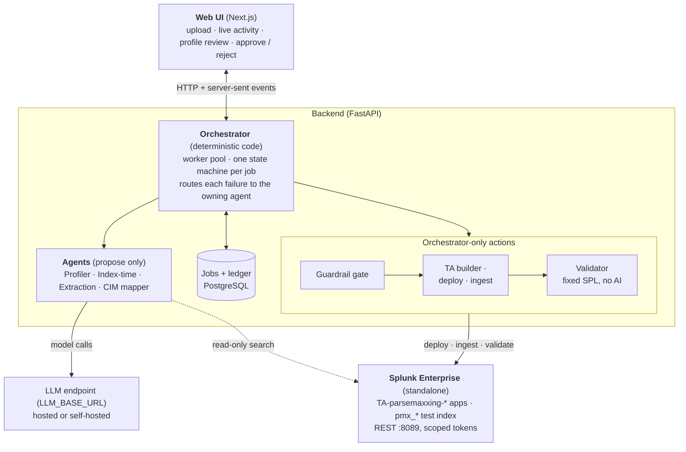
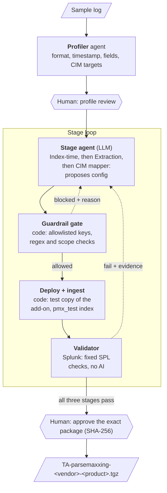
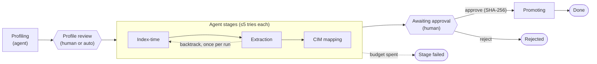
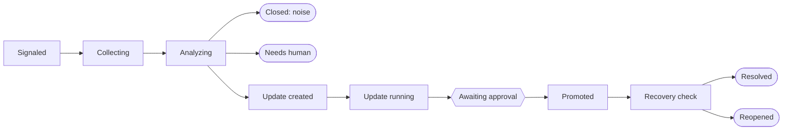
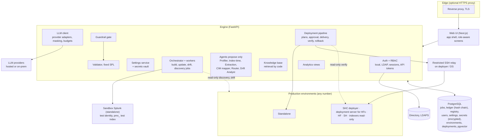

# Parsemaxxing — Design Overview

> Source of truth for development. Last updated Nov 18, 2026. Sections and rows marked **planned** are designed but not built; everything else describes the code as it is. What is built is also listed in [features.md](features.md); the phases that build the rest are in [build-plan.md](build-plan.md).
>
> **How this document is organised.** The first part describes v1, the code as it is (one standalone Splunk, one LLM provider, no users, settings in `.env`). Where v2 replaces a v1 part, that part says **Superseded** and points to the v2 section. The second part, [v2 platform design](#v2-platform-design), describes the multi-environment platform; all of it is **planned**, with the phase that builds each section.

## Overview

Parsemaxxing turns raw sample logs into a tested, CIM-compliant Splunk add-on (TA), deployed to Splunk Enterprise and packaged as a `.tgz`, with LLM agents doing the parsing work and Splunk itself verifying the result.

**Problem.** Every new data source in a SOC needs a parser: line breaking, timestamps, field extractions and CIM mapping. Writing and testing `props.conf` and `transforms.conf` by hand takes hours per source, and mistakes at index time corrupt data permanently.

**Solution.** A team of agents studies the logs, writes the TA stage by stage, deploys it to a standalone Splunk Enterprise instance, ingests the samples into a test index, and fixes its own work until fixed validation searches pass. A human approves before anything is promoted.

**LLM (v1, built).** One OpenAI-compatible endpoint, set by `LLM_BASE_URL`, `LLM_MODEL` and `LLM_API_KEY`. The default is the Meta Model API (`muse-spark-1.3`, standard mode); an on-prem mode is the same code with a self-hosted model behind a different `LLM_BASE_URL`, so logs never leave the network. **Superseded** by [7.6 LLM providers and per-agent models](#76-llm-providers-and-per-agent-models) (Phase 16).

**Summary:** from raw log to CIM-compliant add-on in minutes instead of hours, verified by Splunk, not by the model.

## Scope and design principles

v1 targets one standalone Splunk Enterprise instance, four log formats and three CIM data models. **Superseded in part** by the v2 scope: any number of Splunk environments of any topology ([7.1](#71-environments-customers-and-topology)), production delivery ([7.2](#72-deployment-pipeline-build-and-deploy-are-separate)), all CIM data models ([7.16](#716-cim-data-models-from-each-environment-and-data-model-selection)), more formats ([7.17](#717-log-formats)), discovery ([7.9](#79-discovery)) and overlay fixes of other add-ons ([7.18](#718-fixing-existing-add-ons-with-overlays)). Splunk Cloud stays out of scope.

| In scope | Out of scope (for now) |
| --- | --- |
| Splunk Enterprise standalone (all-in-one) | Splunk Cloud, clusters, deployer, forwarders |
| Formats: JSON, key=value, syslog, CSV | XML, binary, exotic vendor formats |
| CIM: Authentication, Network_Traffic, Web | Other data models |
| TA in `/opt/splunk/etc/apps/TA-parsemaxxing-<vendor>-<product>` | Production rollout across a fleet |
| Any log as uploaded: synthetic generator samples (checked against their truth manifest) and logs without one (checked mechanically, meaning approved by a human) | Committing real or customer logs to this public repo (only synthetic fixtures live here) |
| Logs supplied by upload (a drop folder is planned) | Automatic discovery of unparsed data inside Splunk (dropped in v1; v2 plans a manual, read-only, masked version: [7.9](#79-discovery)) |
| Dedicated inputs; shared syslog feeds (routing by index-time sourcetype rename) planned | Writing inputs.conf (left to the input owner) |
| Parser updates for TAs built by Parsemaxxing (drift monitoring planned) | Updating TAs not built by Parsemaxxing (v2 plans overlay add-ons: [7.18](#718-fixing-existing-add-ons-with-overlays)) |

**Principles**

1. **The model reasons, the tools act, Splunk judges.** Agents propose configs; code deploys them; fixed SPL checks decide pass or fail.
2. **Agents never grade themselves.** An agent may search to investigate, but only the Validator moves the run forward.
3. **Orchestrated by code, not by an AI manager.** A deterministic state machine owns order, retries and budgets.
4. **Fresh, focused context per agent.** Agents never share a conversation; each gets a curated package from the run ledger.
5. **Score only what is achievable.** CIM checks count required fields and fields the source actually has, never fields the log never carried.
6. **Stop honestly.** When a budget runs out, the run ends with a clear report of what it could not solve.
7. **Human in the loop** at profile review and before promotion.

## System architecture

Three layers: a web UI, a FastAPI backend holding the orchestrator, agents and actions, and a standalone Splunk Enterprise instance reached only over REST. This is the v1 architecture as built; the v2 target is in [v2 target architecture](#v2-target-architecture).



Router and Drift Analyst agents are future enhancements; see Mixed feeds and Drift pipeline.

Agents only reason and search read-only; every write to Splunk goes through orchestrator code and the guardrail gate. The LLM endpoint is the Meta Model API by default, or a self-hosted model by changing `LLM_BASE_URL`.

## AI agent architecture

Four agents (a Router for shared feeds and a Drift Analyst are planned) each own one part of the TA, return a strict schema-validated object, and are judged by their own checks. Agents never talk to each other or deploy anything.

| Agent | Job | Owns (writes) | Output | Judged by |
| --- | --- | --- | --- | --- |
| Profiler | Understand the logs | Nothing | `LogProfile` | Human profile review |
| Index-time | Split events and timestamp them | `LINE_BREAKER`, `SHOULD_LINEMERGE`, `TIME_PREFIX`, `TIME_FORMAT`, `MAX_TIMESTAMP_LOOKAHEAD`, `TZ`, `TRUNCATE` | Index-time stanza | Event count, parser warnings, `_time` accuracy |
| Extraction | Get the fields out | `KV_MODE`, `EXTRACT-`, `REPORT-` + `transforms.conf` | Search-time stanza | Field coverage, greedy-regex and duplicate checks |
| CIM mapper | Normalize to CIM | `FIELDALIAS`, `EVAL`, lookups, `eventtypes.conf`, `tags.conf` | CIM config | Required fields, allowed values, child datasets |

How one run moves through the agents, with each proposal gated by code and judged by Splunk:



**LogProfile contents:** format, multiline flag, timestamp example and format candidates, timezone hints, vendor/product guess, sourcetype name, field inventory with coverage, event categories, target CIM models. Every later stage builds on it, and its field inventory defines what CIM fields are achievable.

### Context each agent receives

| Agent | Gets | Does not get |
| --- | --- | --- |
| Profiler | Raw samples | Anything else |
| Index-time | Profile, samples, current index-time stanza, its own past failures | Extraction or CIM work |
| Extraction | Profile, correctly broken events from Splunk, current extraction config, its own past failures | Index-time history |
| CIM mapper | Profile, extracted fields with real values, CIM spec for the target model, its own past failures | Raw regex attempts |

The TA files on disk are the source of truth: each attempt reads them fresh rather than relying on the agent's memory of what it wrote.

Code prepares this context; agents do not call tools themselves. Search-time stages reuse the events indexed by the passing index-time attempt and only reinstall the add-on, so they cost no ingest.

### Tools

Agents call no tools: in the lab, forced tool calls returned HTTP 400 on the Meta Model API, and the context prepared by code (the table above) covers what they need. Two tools are built and used by code instead:

- **`test_regex`** runs inside the guardrail gate: an `EXTRACT-` regex that matches none of the sample events, or that backtracks catastrophically, is blocked, and the reason goes back to the agent. It uses the Python `regex` package, a close match to Splunk's PCRE; the Validator in Splunk stays the real proof.
- **`run_search`** (code-owned base search, command allowlist, 50 rows) is built and tested, ready for agents that investigate on their own.

Deploy, reload and ingest are orchestrator code only. The 1M-token context lets the CIM spec and large samples sit in one prompt without retrieval.

## Orchestrator state machine

A run moves through eight states in a fixed order; the agent stages each loop until their checks pass, and every transition is saved to PostgreSQL before the next step.



End states: **Done** (TA ready), **Stage failed** (an agent stage spent its budget; honest report), **Rejected** (a human rejected it; nothing is promoted) and **Error** (from any state; an unrecoverable infrastructure failure).

For shared feeds, an optional Routing state runs between Profile review and Index-time. Any agent stage that spends its budget goes to Stage failed. Two extra rules apply inside the stages: after a pass, earlier stages' checks re-run to catch regressions, and a later stage may send the run back to an earlier one once per run (for example, missing fields caused by merged events go back to Index-time).

Saving on every transition gives crash recovery (resume from the last state), the live UI (it reads state and ledger), and a full audit trail for the report.

## End-to-end workflow

A run goes from upload to an approved `.tgz` in eight steps; steps 4 to 6 each repeat an inner loop until their checks pass or their budget runs out.

1. **Intake.** A sample log is uploaded (UI, API or CLI). A job is queued (duplicates rejected), and a free worker claims it.
2. **Profile.** The Profiler reads the samples and returns a `LogProfile`.
3. **Profile review.** The user confirms or corrects vendor, product, sourcetype and timezone. Can be skipped per run, except when the timestamps carry no zone and none was stated.
4. **Index-time stage.** Line breaking and timestamps.
5. **Extraction stage.** Search-time fields.
6. **CIM stage.** Aliases, evals, lookups, eventtypes, tags.
7. **Approval.** The user reviews raw vs parsed events side by side (each extracted value highlighted in the raw line, `_time` next to the raw timestamp) and a raw value → field → CIM field → normalized value table, plus the scores and final configs. They approve or reject; a rejected run promotes nothing. Correcting a mapping from the report, sent back to the owning stage as evidence, is planned.
8. **Promote.** Code renames the approved package to its real names, installs it as `TA-parsemaxxing-<vendor>-<product>`, runs a smoke test and registers the version.

### Inner loop for every stage attempt

1. **Generate:** the stage's agent gets its curated context and returns its config (schema-validated).
2. **Gate:** guardrails check it: a key allowlist with typed values and bounds, regex safety and scope. After install, any splunkd warning about the test add-on fails the attempt and becomes evidence. splunkd does not warn about unknown or misspelled keys, so the allowlist is the syntax control. No shell, sidecar or Docker socket ([lab-findings.md](lab-findings.md), Q7).
3. **Deploy:** install the complete `.tgz` under its test identity (see Test identity) through the `apps/local` REST endpoint with `update=true`, from a shared packages folder; never through the `configs/conf-*` endpoints, and no restart ([lab-findings.md](lab-findings.md#q6-deploy-path), Q6).
4. **Ingest:** post the samples to `receivers/simple` into the one shared test index, `PARSEMAXXING_TEST_INDEX` (`pmx_test`), created once at setup; the engine never creates or deletes indexes. A new sourcetype's index-time settings apply to the very next ingest with no reload. Each attempt has its own sourcetype (see Test identity), and every Validator search filters on it, so attempts and jobs never mix. Then wait until the event count is stable ([lab-findings.md](lab-findings.md), Q3, Q8 and Q9).
5. **Validate:** run that stage's fixed SPL checks, plus a quick regression re-run of earlier stages' checks.
6. **Decide:** pass moves to the next stage; fail returns to the same agent with evidence (expected, actual, up to 3 failing events).

### Failure handling

| Failure | Example | Response | Counts against budget |
| --- | --- | --- | --- |
| Bad output | Invalid JSON from the model | Ask again, same context | Separate cap of 2 |
| Guardrail block | Tried to write `inputs.conf` | Retry with the block reason | Yes |
| Infra error | Splunk REST timeout | Retry with backoff, no model call | No |
| Validation fail | `_time` off by 10,800 s on every event | Retry with evidence | Yes |
| Earlier-stage cause | Fields missing because events merged | Backtrack to the owning stage, at most once per run | Yes |

**Budgets:** 5 attempts per stage, a token/cost ceiling per run, 15 minutes wall-clock. The first limit hit ends the run in `STAGE_FAILED` with an honest report.

## Test identity

Every test deploy runs under a separate app name and a separate sourcetype name, so untested config never parses production data; the real names are restored by code only at promotion.

**Why.** `props.conf` stanzas are keyed by sourcetype. A test TA reusing the real sourcetype would merge with the installed TA, and Splunk precedence would decide which settings parse live data. The same applies to routing: a test rule attached to the real `[syslog]` stanza would reroute production events mid-test.

| Item | Production name | Test name |
| --- | --- | --- |
| App | `TA-parsemaxxing-fortinet-fortigate` | `TA-parsemaxxing-fortinet-fortigate__test_<job>` |
| Sourcetype (every stanza, eventtype and search in the copy) | `fortinet:fortigate:traffic` | `fortinet:fortigate:traffic__test_<job>_a<attempt>` |
| Transforms | `parsemaxxing_<job>_…` | Same prefix plus `__test` |

Every attempt is a new sourcetype: the case the lab proved applies without a reload (Q3), and what separates attempts inside the one shared test index.

**Applies to** new builds and parser updates alike: samples are ingested into the test index with the test sourcetype, and test apps are removed with the job's other test resources.

**At promotion.** Code, never the agent, renames the tested package back to the real names. The human approves the test package's SHA-256; promotion derives the real package by code from exactly those approved bytes. Packages are built reproducibly, so the promoted hash is deterministic; both hashes are recorded and linked, and a smoke test runs right after promotion.

## Uploads

Each job takes a sample log from one log source, raw as the source writes it, plus optional form fields; the model learns from a sample while the Validator tests on the whole file.

**What to upload**

- One log source per job (e.g. a FortiGate traffic log), one file
- Formats in scope: JSON, key=value, syslog, CSV, as `.log`, `.txt`, `.json`, `.csv` or single-file `.gz`; no archives (v2 adds formats and `.xml`, `.tsv`: [7.17](#717-log-formats), Phase 17c)
- Raw as written by the source, not re-saved in Excel
- Minimum about 50 events; maximum 10 MB per job, measured after decompression
- Content checked on upload (text, UTF-8, line endings), not just the extension

**Optional form fields**

| Field | Why |
| --- | --- |
| Vendor / product | Naming and CIM mapping; otherwise the Profiler proposes them |
| Timezone of the logs | Prevents the classic +3 h error when timestamps carry no zone; without it, such a run asks in profile review |
| Skip profile review | Unattended runs |
| Update of a promoted TA | Starts a parser update instead of a new build |

Planned: how logs reach Splunk (file monitor, syslog, HEC), the current sourcetype, the target CIM model, and "shared feed?" for routing.

**Holdout test.** The agents see the first 200 events in time order (the generator mixes event types throughout, so every type is covered), and the CIM mapper's field values come from a `fieldsummary` over those same events. The Validator ingests the full file, so the parser is proven on events the model never saw ("learned from 200 lines, passed on 8,000").

**Drop folder** (planned; the intake helper that refuses symlinks is built). Each new subfolder is one job: the log files plus an optional `job.yaml` with the form fields.

**Getting samples out of Splunk** (when the user has no original file): a plain event search with `| head 500 | reverse`, then Export → Raw Events (or `splunk search … -output rawdata`, or the REST export endpoint with `output_mode=raw`). Before using it, check `max(len(_raw))` and `max(linecount)`: events cut at 10,000 characters are truncated and unusable. The original file on the forwarder or syslog collector is always the better sample.

**Going live** (planned). For a dedicated input, the approval report ends with the exact `inputs.conf` change (e.g. `sourcetype = fortinet:fortigate:traffic` on the input now sending `fw01-2`). Parsemaxxing never writes inputs itself.

**Only the log is uploaded.** A generator sample is recognised by its content hash and validated against its own truth manifest from the repo (a manifest can also be uploaded, and is checked like any input). Any other log has no answer key and is validated mechanically (see "Validation without a manifest"). The `demo/` scenario scripts use synthetic logs only; the repo never holds real ones.

## Concurrency and continuous operation

Every unparsed log source becomes one job in a PostgreSQL queue, and a pool of long-running workers processes jobs in parallel, with database locks guaranteeing that no two workers ever handle the same logs.

### Intake

| Source | How jobs are created |
| --- | --- |
| Upload | The web UI, `POST /uploads`, or `parsemaxxing run <file>` |
| Drop folder | Planned |

### No two workers on the same logs

1. **Claim with `FOR UPDATE SKIP LOCKED`:** a worker atomically sets a queued job to running with its `worker_id` and a lease; other workers skip locked rows.
2. **Duplicate prevention at intake:** a unique constraint on the source key (host + source path, or vendor/product) for active jobs, plus a content hash of the samples. A repeat upload points to the existing job.
3. **Unique sourcetype and TA name per job:** `props.conf` stanzas are keyed by sourcetype, so two TAs defining the same sourcetype would merge unpredictably.

### Operation never stops

| Situation | Behaviour |
| --- | --- |
| Job waits for human review | Worker releases it and takes the next job; the job is requeued when the human acts |
| Job spends its budget | Only that job ends in `STAGE_FAILED` |
| Worker crashes | Lease (~2 min) expires; another worker resumes from the last saved state |
| Worker is slow but alive | Heartbeat renews the lease |
| Service restarts | Workers run with an auto-restart policy; queued jobs persist in PostgreSQL |
| Production data | Untouched: reload not restart, testing only in `pmx_*` indexes |

### Shared limits

- **Splunk writes** (app install, reload) run under one global lock, one job at a time; LLM calls and validation searches run in parallel.
- **Worker count** sized to Splunk's concurrent search limit: `parsemaxxing serve --workers 4` by default.
- **LLM** calls limited to 2 at once, plus a per-job token budget, to protect rate limits and the API credits.

### Credit protection

Credits are spent only on jobs someone started, and always inside hard budgets.

| Control | What it prevents |
| --- | --- |
| Token estimate at upload; a log estimated over the per-run ceiling is refused | Surprise spend on a large sample |
| Sampling: the agents see 200 events, never the whole file | Sending whole log files to the model |
| Duplicate check by content hash | Paying twice for logs already parsed; a repeat upload points to the earlier job |
| Per-job token budget | One stubborn source draining credits |
| Global daily token budget (2M) and kill switch | Runaway spend; workers stop claiming jobs and the UI shows why (v2 applies it across all providers with cost from registry prices: [7.6](#76-llm-providers-and-per-agent-models)) |
| Spend limit on the provider's billing page | Anything the code misses |

In the lab, four uploads at once ran on four workers in parallel, one pausing for review while the others continued (`demo/04_parallel_jobs.sh`).

## Mixed feeds and sourcetype assignment (planned)

> Not built. **Superseded** as a plan by [7.11 Mixed-feed routing](#711-mixed-feed-routing-topology-aware) (Phase 23, which replaces old Phase 9). The design below still holds and 7.11 extends it.

Parsing only works once events carry the right sourcetype, so Parsemaxxing also handles how events get it, including shared feeds where many vendors arrive under one generic sourcetype such as `syslog`.

Every event in Splunk already has a sourcetype, often a meaningless one: set generically in `inputs.conf` (`syslog`), matched by a pretrained type, or invented from the file name (`fw01-2`, `fw01-too_small`).

### Two cases

| Case | Example | What Parsemaxxing does |
| --- | --- | --- |
| Dedicated input | A forwarder monitoring `/var/log/remote/fw01/` only | No agent work: the approval report ends with the exact `inputs.conf` change to copy, e.g. `sourcetype = fortinet:fortigate:traffic` |
| Shared feed | UDP/TCP 514 with `sourcetype = syslog` carrying FortiGate, Cisco, Palo Alto and Linux | Runs the Routing stage to split the target vendor out by index-time rename |

Parsemaxxing never writes `inputs.conf` itself; changing inputs stays with the person who owns them.

### Routing config the agent produces

```ini
# props.conf
[syslog]
TRANSFORMS-parsemaxxing_route_fgt = parsemaxxing_route_fortigate

# transforms.conf
[parsemaxxing_route_fortigate]
REGEX = devid="?FG[0-9A-Z]+
DEST_KEY = MetaData:Sourcetype
FORMAT = sourcetype::fortinet:fortigate
```

### Two traps the agents must handle

1. **The new sourcetype's index-time settings do not apply to routed events.** Splunk breaks events and extracts timestamps before the routing transform runs, using the original `[syslog]` rules. Only search-time settings of the new sourcetype take effect. So for routed data, index-time settings go in a `[host::...]` or `[source::...]` stanza, or the Index-time agent confirms the generic parsing already handles the data (usually true for single-line syslog).
2. **A broad regex steals other vendors' events.** The rule sits on the shared stanza and touches all data in the feed, so misrouting damages other teams' data.

### Routing stage

An optional stage between Profile review and Index-time, run only when the feed is shared. The Router agent owns the routing regex and transform; it gets the profile, the mixed-feed sample and its own past failures, and may use `run_search` and `test_regex`.

| Check | How | Pass when |
| --- | --- | --- |
| Positive routing | Ingest the mixed sample as the generic sourcetype; count target events by sourcetype | 100% of target events carry the new sourcetype |
| Negative routing | Count non-target events that were renamed | Exactly 0 |
| Index-time on routed data | `_time` and event count checks on the routed events | Same rules as the Index-time stage |

The negative test needs the whole mixed feed, not only the target device, so the upload includes it (or the generator produces a synthetic multi-vendor feed with a manifest of which line belongs to which vendor).

### Upload form additions

| Field | Effect |
| --- | --- |
| Current sourcetype (e.g. `syslog`, `fw01-2`) | Used to ingest test data exactly as production receives it |
| Shared feed? | No: Case 1, `inputs.conf` instruction only. Yes: Routing stage runs |

### Guardrail exception

The key allowlist normally blocks touching generic stanzas. One narrow exception: a `TRANSFORMS-` entry on the generic stanza is allowed only when its transform has `DEST_KEY = MetaData:Sourcetype`. Routing becomes possible; nothing else on the shared stanza is.


## Parser updates

When a log format changes, an update job patches the existing TA with the smallest change that works, and must prove that both the old and the new format still parse, because after a firmware upgrade both usually coexist for a while.

**TA registry.** Every TA that Parsemaxxing builds is stored with its versions, original samples, truth manifest and baseline. The old samples become the regression set, so they are kept for as long as the TA exists.

**Update flow**

1. **Select and upload.** Pick a registered TA and upload new-format samples (automatically from the drift pipeline, when that is built).
2. **Diagnose, no AI.** The current TA is tested on the new samples with the normal Validator, producing a drift report (e.g. timestamps fail, `srcip` renamed `src_ip`, new action value `deny-policy`). If everything passes, the job ends with zero credits spent.
3. **Patch mode.** Only agents owning failing checks run. Each gets the current config, the drift evidence and the instruction to make the minimal change (add a timestamp format, extend a regex), never a rewrite.
4. **Regression.** The patched TA must pass on the old registry samples and the new samples. Breaking the old format rejects the attempt with evidence.
5. **Review.** Line-by-line diff against the production version, raw vs parsed for an old and a new event, version bump in `app.conf` (e.g. 1.2.0 → 1.3.0), hash-bound approval, rollback to the exact previous version.

**Promotion of an update.** The app is updated in place via REST: `default/`, `metadata/` and `lookups/` are replaced; `local/` (admin overrides) is kept and never written by Parsemaxxing; the previous version stays in the registry for rollback. Before promotion, Parsemaxxing checks the installed TA's `local/` files: if any override a setting the patch changed (e.g. an old `TIME_FORMAT` in `local/props.conf`), the review flags that the fix will not take effect until a human updates or removes the override. Search-time changes apply to past events immediately; index-time changes apply only to data indexed after the reload.

**Job type:** update, with states Diagnose → failing stages only → Regression → Approval → Promote.

**As built.** The update job installs the production TA from its kept, hash-checked package under the job's test identity, and ingests the new samples and every registered version's samples under one test sourcetype per attempt, told apart by `source`; every check runs on every set. A later stage that passes as it is is not patched. A patch may add eventtypes but never drop or rename a production one. Updates are a minor version above the highest registered version (so an update after a rollback never reuses a number). Promotion uses `update=true` only over a TA the registry lists at the expected version whose installed `app.conf` carries the Parsemaxxing marker; the lab confirmed `update=true` keeps `local/` ([lab-findings.md](lab-findings.md), Q11). Overrides are flagged by comparing the effective settings with the TA's own `default/`, and with Splunk's documented defaults for keys the TA does not set. After the in-place install the effective settings are read back, and a changed key that is not in effect fails the smoke test. Registered samples are read only from the engine's private runs folder, never through a link, and only while their intake hashes still match. Promotions and rollbacks of one TA run under one lock. Rollback is CLI only: `parsemaxxing rollback <TA> <version>`.

**Out of scope in v1:** updating TAs not built by Parsemaxxing. Editing a Splunkbase vendor TA directly is lost on the vendor's next upgrade; the right approach, a separate overlay TA, depends on Splunk app precedence. v2 plans it in [7.18](#718-fixing-existing-add-ons-with-overlays) (Phase 21b). v1 rollback (CLI only, sandbox only) is **superseded** by [7.15 Add-on version control](#715-add-on-version-control) (Phase 17b).

## Drift pipeline (planned)

> Not built. **Superseded** as a plan by [7.10 Drift pipeline and masking](#710-drift-pipeline-multi-environment-and-masking) (Phase 22, which replaces old Phase 8). The design below still holds for one environment and 7.10 extends it. Parser updates, which it would trigger, are built; today a person starts them with a new sample.

Parsemaxxing watches the parsers it built: Splunk alerts detect a format change for free, code collects masked samples, a Drift Analyst agent decides whether the change is real, and an update job is created automatically, so the only manual step is approving the fix.

Example used below: a FortiGate firmware upgrade changes the log format at 14:00.

### Steps

0. **Setup at promotion.** The registry stores a baseline (field coverage, CIM values seen, eventtype match rate, volume). Alert searches are installed in a separate Parsemaxxing monitoring app from fixed templates with only the sourcetype and baseline numbers filled in; no agent writes them. Splunk's scheduler runs them (e.g. every 15 minutes); Parsemaxxing spends nothing until one triggers.
1. **Alert fires (14:15).** Splunk's webhook alert action posts TA ID, signal, sourcetype, count and window to FastAPI. The endpoint uses a secret token in the URL and accepts only the Splunk server's address, since the webhook cannot send auth headers.
2. **Dedup and grouping (code).** Signals for a TA with an open drift job attach to it; signals within minutes become one job; a TA closed as noise in the last hour is in cooldown.
3. **Collection (code, no AI).** With a read-only account limited to registered sourcetypes: change point (`timechart span=5m` of failing vs normal), affected hosts (e.g. 7 of 20, a partial rollout), failing samples grouped by shape, normal events from the same window, truncation check. Values are masked with consistent, format-preserving fakes, so regexes built from them still hold; the masking map also gives partial ground truth.
4. **Drift Analyst agent.** Gets only the evidence bundle and one narrow tool, `fetch_more_samples(pattern, n)`, run by the collector with masking. Returns verdict, change start, affected hosts, summary, stages affected, representative samples and confidence. Code also requires sustained volume (more than N events over more than M minutes) before a real-change verdict counts.
5. **Update job created.** New samples from the analyst, old samples from the registry, only the affected stages; then the parser update flow.
6. **Human approval.** Notification (a UI badge; email or Slack later); review shows the drift report, the diff, and old and new events passing.
7. **Recovery.** The alerts must go quiet for the next runs, then the job closes as resolved, or reopens with new evidence. The baseline is updated. A damage report states that search-time fixes apply to past events but index-time fixes do not (e.g. "12,340 events indexed 14:02–14:41 have wrong timestamps; re-ingest from source if needed").

### Detection signals

| Signal | Catches |
| --- | --- |
| `DateParserVerbose` warnings for the sourcetype | Timestamp format change |
| Line-breaking warnings for the sourcetype | Event structure change |
| Key field coverage below baseline | Renamed or moved field |
| CIM values outside the allowed set | New vendor values |
| Rising events with no eventtype or tag | New event types |

### Analyst outcomes

| Verdict | Result |
| --- | --- |
| Noise | Closed with explanation; cooldown starts |
| Needs human | Truncated events or low confidence: asks for a raw file upload |
| Real change | Update job created automatically |

### Drift job states



Same PostgreSQL queue, locking, persistence, budgets and kill switch as build jobs.

### Production access, deliberately narrow

Unlike the v1 discovery idea that was dropped, drift monitoring only reads sourcetypes Parsemaxxing built, and samples are usually intact because a timestamp or field change leaves `_raw` untouched. Masking (or an on-prem model) applies before any model call.

**Credits:** detection, dedup and collection use none; the Analyst runs once per drift job; the update job runs only affected stages.


## Validation design

The Validator is code plus fixed SPL, no AI: it runs searches through the Splunk Python SDK (`jobs.oneshot`, JSON output) and applies a pass/fail rule to each result.

**Mechanics**

- Wait for indexing: poll `| tstats count where index=<test_index>` until two consecutive polls match.
- Always search `earliest=0`, because samples carry historical timestamps.
- Ground truth comes from the synthetic generator's truth manifest (event count, true epoch per event, true field values). For logs without a manifest, the mechanical checks below stand in.

### Validation without a manifest

The agents still do all the work, and the Validator still runs on every event of every attempt, in Splunk; only the answer key changes. Code (never the AI) proves what can be proven from the file itself, and the approval report lists what only meaning can settle.

| Stage | Check | Pass when |
| --- | --- | --- |
| Index-time | Event count | One event per record of the file (non-empty lines; for multi-line logs, lines where a timestamp starts) |
| | Timestamp accuracy | `_time` equals the time written in each event's own line, read by code with the add-on's `TIME_PREFIX`, `TIME_FORMAT` and `TZ` (epoch and ISO 8601 when Splunk recognises the timestamp itself) |
| | Timezone | When the timestamps carry no zone (decided by code: an epoch or a trailing `Z`/offset carries one), `TZ` is the zone a human stated, on the upload form or in profile review. With none stated, the run pauses in profile review, even when review was skipped |
| | Fallback, parser warnings, `TIME_FORMAT` matches | As with a manifest |
| Extraction | Values | Every value appears exactly in its own raw line, trimmed, and does not run into another field (`key=`/`"key":` inside a value) |
| | Coverage, duplicates | Each profile field at its stated coverage; single-valued |
| CIM | Membership | Events reach every data model the add-on tags (no tag: fail) |
| | Required fields, allowed values | Every required field the add-on maps is filled on every event, with only allowed values |
| | Constants | No CIM field fixed to one value while its source field varies |
| | Child datasets | `Failed_Authentication`, `Blocked_Traffic`, … agree with the `action` values |
| CIM (both modes) | Values from the event | Every value the add-on writes into a CIM field occurs in its own raw line, or is one of the field's allowed CIM values (`action=blocked`); only fields constant by design (`vendor_product`, `vendor`, `product`, `app`) are exempt |
| | Directions | No source field feeds both ends of a pair (`src`/`dest`, `src_port`/`dest_port`, `bytes_in`/`bytes_out`, …) |

The last two rows run with a manifest too: a manifest only lists the CIM fields its source has, so a required field filled with the wrong meaning (found in the lab: `src_port` read from `dest_port`, an invented `rule=vpn-access`) passed both modes before.

Parser updates without a manifest: Diagnose snapshots what production gives each registered sample set, and every later check on those sets is exact equality with that snapshot (times, fields, CIM values, matched as multisets so repeated timestamps are fine). New samples without a manifest get the mechanical checks and inherit production's `TZ`.

**What it cannot prove: meaning.** A plausible but wrong timezone that nobody stated, a field mapped to the wrong CIM field, `drop` mapped to `allowed`. The approval report therefore shows "Decisions the agents made" (how the timestamp is read with the first event's result, field meanings, and each source value → CIM value with its count), and approval is where a human vouches for them. The report states which validation ran.

### Index-time checks

| Check | How | Pass when |
| --- | --- | --- |
| Event count | `\| tstats count where index=<idx>` | Equals manifest count |
| Parser warnings | `index=_internal sourcetype=splunkd log_level=WARN` for `DateParserVerbose`, `LineBreakingProcessor`, `AggregatorMiningProcessor` on the test source | Zero |
| Timestamp fallback | Events with abs(`_indextime` − `_time`) < 60 s | Zero |
| Timestamp accuracy | `_time` per event vs manifest epoch | All match |
| `TIME_FORMAT` matches | Code (no SPL): every raw event's timestamp, at `TIME_PREFIX` within `MAX_TIMESTAMP_LOOKAHEAD`, matches `TIME_FORMAT` translated to a pattern | All match. When it does not, Splunk silently guesses the timestamp and can still get `_time` right, so the other checks pass by luck (found in the lab). With no `TIME_FORMAT`, the gate requires `TIME_PREFIX` and `MAX_TIMESTAMP_LOOKAHEAD`: that is how two formats coexist in one sourcetype after an upgrade |

### Extraction checks

| Check | How | Pass when |
| --- | --- | --- |
| Field coverage | `\| fieldsummary` vs the profile's field inventory | Each field at its expected coverage |
| Greedy regex | Values containing delimiters or outlier lengths | Zero events |
| Duplicates | `mvcount(field) > 1` where single-valued is expected | Zero events |
| Value spot-check | Extracted vs manifest values on a sample | All match |

### CIM checks

| Check | How | Pass when |
| --- | --- | --- |
| Reaches the model | `\| tstats summariesonly=false count from datamodel=<Model> where index=<idx>` | Count equals expected events |
| Required fields | `\| datamodel <Model> <Dataset> search` + count per required field | Every required field the source has equals total |
| Allowed values | e.g. `Authentication.action` not in success, failure, unknown | Zero events |
| Child datasets | Failures land in e.g. `Failed_Authentication` | Counts match manifest categories |

**CIM scoring rule (no Vladiator-style false failures):** a field counts as missing only if CIM expects it *and* the source contains it. The report shows three numbers: required fields passed, available fields mapped, and fields not in the source (informational, no penalty). Required fields and allowed values are pinned in `cim_spec/`, never chosen by the model: read from the CIM add-on's own data model definitions (Splunk_SA_CIM 8.7.0; each field's `recommended` flag and `expected_values`) by `python -m parsemaxxing.cim_spec.pin`. Required = the root dataset's recommended fields. The pin to three models from one CIM version is **superseded** by the per-environment CIM library in [7.16](#716-cim-data-models-from-each-environment-and-data-model-selection) (Phase 17c), which keeps this rule. Data model rows are read with `| datamodel <Model> <Dataset> search | search sourcetype=<attempt>`: the model's output has no `index` field, so the attempt's unique sourcetype is the filter.

**Splunk prerequisite:** the CIM index macros (e.g. `cim_Authentication_indexes`) must include `pmx_*`, or CIM checks fail falsely. `make up` sets this; on your own Splunk, set it once.

**Feedback to the agent** is compact: stage, failed check, expected, actual, up to 3 sample events. Precise evidence such as "+10800 s on 40/40 events" points straight at the fix (a wrong `TZ`).

## Guardrails and security

An AI with write access to Splunk is a risk, so every agent output passes a deterministic gate that checks values as well as keys, the workflow itself is tamper-proof, and every Splunk call uses a narrowly scoped account. The Status column says what is built; each built guardrail has adversarial tests in `engine/tests/`.

### Config safety (keys and values)

| Guardrail | Stops | Status |
| --- | --- | --- |
| Key allowlist: parsing keys only | `inputs.conf`, `commands.conf`, anything that executes code | Built |
| Block `DEST_KEY = queue` / `nullQueue` | Silent deletion of events | Built |
| Block `_TCP_ROUTING` and `_MetaData:Index` | Data sent to another output or index | Built |
| Block `INGEST_EVAL` and `SEDCMD-` | Permanent index-time changes to `_raw` or fields | Built |
| Min/max bounds on `TRUNCATE`, `MAX_EVENTS`, `MAX_TIMESTAMP_LOOKAHEAD` | Giant events and pipeline memory problems | Built |
| `EVAL-`/`FIELDALIAS-` may not target `index`, `host`, `source`, `sourcetype`, `_time`, `_raw` | Corrupting core fields for every search | Built |
| No `[default]`, no broad `[source::...]` or `[host::*]` | Changing parsing for all data | Built |
| No lookups: `LOOKUP-` and `lookup()` are refused | External lookups that run scripts | Built |
| Routing exception: a `TRANSFORMS-` on a generic stanza only with `DEST_KEY = MetaData:Sourcetype`, and 0 misrouted events in the negative test | Any other change to a shared stanza | Planned, with routing |
| Key allowlist with typed values before deploy, plus a post-install splunkd-warning check that fails closed: any warning about the test add-on fails the attempt (lab Q7) | Syntax errors, unknown or mistyped keys | Built |
| Regex catastrophic-backtracking test | Stalling the parsing pipeline | Built |

### TA builder

| Guardrail | Stops | Status |
| --- | --- | --- |
| Reject newlines in values; one escaping conf writer | A value injecting a new stanza such as `[script://…]` | Built |
| Names match `^[a-z0-9_:-]+$`; code adds the fixed prefix `TA-parsemaxxing-` and the pattern applies only to the vendor and product parts; resolved paths must stay inside the TA folder | Path traversal out of the app | Built |
| Package file allowlist: `default/`, `metadata/`, `lookups/` (CSV), `README`, `app.conf` | `bin/` scripts, `appserver/static` JavaScript in Splunk Web | Built |
| Prefix every transform `parsemaxxing_<job>_`; collision check by reading existing transform names over REST (`configs/conf-transforms`) before deploy (lab Q7) | Overriding another app's global transform name | Built |
| TA named `TA-parsemaxxing-<vendor>-<product>`; refuse if the name exists | Overwriting (and later deleting) a Splunkbase vendor TA | Built |

### Validator integrity (no gaming)

| Guardrail | Stops | Status |
| --- | --- | --- |
| Flag CIM fields with one constant value where the source varies; every CIM field must trace to a source field or an approved constant | `EVAL-action = "success"` passing the allowed-values check | Built |
| Manifest value checks and provenance shown in review | Unrelated fields aliased just to fill required fields | Built |
| Holdout test on the full file; flag literal sample values in regexes | Regexes overfitted to the sample | Built |
| Agents have no file tools; the builder writes only inside the TA | Agents editing `cim_spec/`, manifests or the Validator | Built |

### Untrusted input

| Guardrail | Stops | Status |
| --- | --- | --- |
| Logs, form fields and `run_search` results passed as data, never instructions | Prompt injection planting a backdoor config | Built |
| Schema validation of every agent output | Malformed or malicious proposals | Built |
| Human correction text passed as data | Injection through review comments | Built |
| Cap decompressed size; single-file `.gz` only, no archives | Decompression bombs, zip-slip | Built |
| Content-based file checks (text, UTF-8) | Binary or disguised files | Built |
| Never follow symlinks at intake | A drop-folder link to `/etc/shadow` being read and sent to the model | Built (intake helper; the drop folder is planned) |
| Secret scan of samples; warning banner and masking option for real logs | Passwords or tokens in logs reaching a hosted model | Planned (README warns against real logs; masking module [7.10](#710-drift-pipeline-multi-environment-and-masking), Phase 21) |

### Splunk resources

| Guardrail | Stops | Status |
| --- | --- | --- |
| Per-job and daily byte caps on test ingestion | Test data consuming the Splunk license | Built |
| One shared test index, created at setup; the engine never creates or deletes indexes, and removes each job's test add-on after the run | Disk exhaustion; deleting resources that existed before | Built |
| Code rejects any ingest target not starting with `pmx_` | Test data landing in a real index | Built |
| Code owns the base search (`search index=<test index> sourcetype=<own attempt sourcetype>`); a search may only append a `|` pipeline of allowlisted commands (`stats`, `eval`, `where`, `table`, `fieldsummary`, `head`, …), 50 rows, short timeout; commands that start a new result set (`tstats`, `datamodel`, `inputlookup`, `join`, `append*`, …) are refused and stay with the Validator's fixed SPL (T1.2) | `delete`, `collect`, `dbxquery`, `loadjob`, custom commands, other apps' lookups, reading other jobs' samples | Built |
| Rollback reinstalls the exact previous registered version (`parsemaxxing rollback <TA> <version>`) | A bad update staying in production | Built (routing-transform cleanup planned, with routing) |

### Workflow integrity

| Guardrail | Stops | Status |
| --- | --- | --- |
| Approval bound to the SHA-256 of the exact `.tgz`; promotion deploys only that hash; any later change needs re-approval | A TA modified between validation, approval and deploy | Built |
| State transitions enforced in the database (`UPDATE … WHERE status = 'awaiting_approval'`) | Skipping validation or approval; replayed approve or promote requests | Built |
| Before ingesting, assert the attempt's sourcetype has 0 events in the shared test index, else bump the attempt number; never reuse a sourcetype, including on resume (T4.5) | Duplicate events after a retried ingest failing the count check | Built |
| On resume after a crash, remove the job's own test add-on before the attempt reinstalls it | Acting on an ambiguous deploy outcome | Built |
| Adversarial regression suite (`nullQueue`, newline injection, path traversal, injected log lines, constant-value gaming) run on every change | Old bypasses returning | Built |
| Ledger records model version, Validator version, CIM spec hash and artifact hash per run | Results that cannot be reproduced | Planned (package hashes are recorded) |
| Append-only ledger | Edited audit history | Built |
| Timeouts on every Splunk and model call | Hung workers | Built |
| Test identity: separate app and sourcetype names for every test deploy; rename back by code at promotion with both hashes linked and a smoke test | Untested config or routing rules parsing production data during testing | Built |

### Secrets and platform

| Guardrail | Stops | Status |
| --- | --- | --- |
| `.env` in `.gitignore`, `.env.example`, pre-commit secret scan | Tokens and API keys in the public repo | Built |
| No credentials in prompts; redaction in logs and ledger | Secrets leaking through the model or audit trail | Built |
| Log text rendered only as escaped text; highlights built as React elements | XSS from `<script>` in log lines in the raw vs parsed view | Built |
| Login; approve and promote need an approver role | Anyone reaching the API approving changes | Planned (localhost only today, R1; [7.3](#73-authentication-and-authorization), Phase 13) |
| Approval needs a second confirmation; high-risk changes (routing on shared stanzas) flagged | Risky approvals looking routine | Built (routing flag planned) |
| Pinned dependencies with hashes, images by digest | Supply-chain drift in the public repo | Built (Phase 12, R12 closed; CIM package checksum planned, Phase 17c) |

### Splunk service accounts (token auth)

| Account | Used by | Can |
| --- | --- | --- |
| `parsemaxxing_search` | Agents' `run_search`, the Validator | Search only `pmx_*` and `_internal` |
| `parsemaxxing_deploy` | Orchestrator code only, never a model | Install and update apps, reload, oneshot into `pmx_*` |
| `parsemaxxing_drift` | Drift collector code only (planned; `make up` already creates the account) | Read-only, role search filter limited to registered sourcetypes |

The deploy role's capabilities for app install were confirmed in the lab ([lab-findings.md](lab-findings.md), Q9), and `make up` creates all three accounts with a fresh 7-day token each. These accounts stay for the sandbox. **Superseded** for production environments by per-environment accounts (`parsemaxxing_read`, `parsemaxxing_deploy`) in [7.1](#71-environments-customers-and-topology) (Phase 17).

### Deferred

Per-resource authorization and approver ≠ submitter (multi-team use), upload rate limits, TLS verification and token rotation (the lab uses self-signed certificates), data retention policy (samples kept while the TA exists; uploads deleted after the job), PostgreSQL backups. v2 plans each of these: roles and optional four-eyes ([7.3](#73-authentication-and-authorization), D6), rate limits and TLS verification ([7.7](#77-security-baseline)), real-log retention ([7.19](#719-real-log-retention-30-days-at-most)), encrypted backups ([7.5](#75-settings-from-the-ui-and-the-secrets-vault)).

In the lab, an injected instruction in a log line, a gate-blocked proposal and a constant `action` caught by the Validator are reproduced by `demo/03_guardrail_block.sh`.

## Build details

Plain Python, no agent framework: the flow is fixed and small, and readable code is easier to debug and to review. v2 keeps this (D8).

### Tech stack

| Layer | Choice | Reason | Status |
| --- | --- | --- | --- |
| LLM client | `openai` SDK, `base_url=https://api.meta.ai/v1`, model `muse-spark-1.3` (env vars `LLM_BASE_URL`, `LLM_MODEL`) | One OpenAI-compatible client covers the hosted and the on-prem endpoint | Built (moves to `llm/` adapters in Phase 16) |
| Schemas | `pydantic` | Strict validation of every agent output and API body | Built |
| Backend | FastAPI | Async API and server-sent events | Built |
| Splunk | `splunk-sdk` over REST :8089, token auth | Official SDK for search, app install and ingest | Built |
| Ledger | PostgreSQL: job queue and ledger, written on every state transition | One store for queue, locks and audit trail | Built |
| UI | Next.js + shadcn/ui, live updates over server-sent events from FastAPI | Accessible components, no business logic in the client | Built |
| Lab | Splunk Enterprise standalone on a VM | Real Splunk for the lab probes | Built |
| Local stack | `docker-compose.yml` with the official Splunk Enterprise image + the app | One-command setup (`make up`) | Built |
| LDAP | `ldap3` | Pure-Python client with LDAPS, StartTLS and RFC 4515 filter escaping ([7.4](#74-ldap)) | Planned (Phase 14) |
| Password hashing | `argon2-cffi` | Argon2id, the OWASP-recommended algorithm ([7.3](#73-authentication-and-authorization)) | Planned (Phase 13) |
| MFA | `pyotp` | TOTP per RFC 6238 ([7.3](#73-authentication-and-authorization)) | Planned (Phase 13) |
| Encryption | `cryptography` | AES-256-GCM envelope encryption for the vault; no custom crypto ([7.5](#75-settings-from-the-ui-and-the-secrets-vault)) | Built (Phase 12) |
| LLM client (Anthropic) | `anthropic` SDK | Adapter for the `anthropic` provider kind; the `openai` SDK stays for OpenAI-compatible and Azure ([7.6](#76-llm-providers-and-per-agent-models)) | Planned (Phase 16) |
| Vector search | `pgvector` extension (`pgvector/pgvector` image pinned by digest) | Retrieval inside the existing PostgreSQL, no extra service ([7.12](#712-knowledge-base-rag)) | Planned (Phase 20) |
| Embeddings | `fastembed` (ONNX, small English model, files pinned by SHA-256) | Local embeddings, so nothing leaves the network and offline servers work ([7.12](#712-knowledge-base-rag)) | Planned (Phase 20; model choice is Q19) |
| SSH client for the relay | `asyncssh` or `paramiko`, open question Q18 | Host key pinning and Ed25519 keys for the restricted relay ([7.2](#72-deployment-pipeline-build-and-deploy-are-separate)); picked after checking maintenance and CVE history | Planned (Phase 18; choice in Phase 11) |
| Charts | To be chosen by `frontend`, open question Q19 | Accessible charts in the repo's colour tokens; licence must allow commercial use ([7.8](#78-analytics)) | Planned (Phase 19; choice in Phase 11) |
| XML parsing | `defusedxml` | No external entities and no entity expansion in any XML the engine parses ([7.17](#717-log-formats)) | Planned (Phase 17c) |
| PDF text extraction | A maintained, pinned library, licence checked, chosen in Phase 20 | Imported Splunk manual PDFs ([7.12](#712-knowledge-base-rag)) | Planned (Phase 20) |
| Backup encryption | `age` | Encrypted `pg_dump` with a public key from settings ([7.5](#75-settings-from-the-ui-and-the-secrets-vault)) | Built (Phase 12; Debian package in the engine image) |
| HTTPS reverse proxy | Caddy (`caddy` image pinned by digest), optional `https` compose profile | TLS with an internal CA or an admin certificate, and HSTS, in front of the web UI with a few lines of config ([7.13](#713-ux-navigation-and-the-platform-ui)) | Built (Phase 12) |
| Image scan | Trivy (`aquasecurity/trivy` image pinned by digest) | Fails CI on fixable HIGH and CRITICAL findings; reviewed exceptions in `.trivyignore` ([7.7](#77-security-baseline), A03) | Built (Phase 12) |
| SBOM | Syft (`anchore/syft` image pinned by digest) | CycloneDX SBOM per built image, kept as a CI artifact ([7.7](#77-security-baseline), A03) | Built (Phase 12) |
| Docker TCP relay | `scripts/tcp_forward.py`, standard library only, in the pinned `python` image | Lets the engine reach Splunk's port 8089 (`splunk-api`) and the host CLI reach PostgreSQL (`cli` profile) without Splunk sharing a network with the engine or PostgreSQL being on a published network ([7.13](#713-ux-navigation-and-the-platform-ui)) | Built (Phase 12) |

### Platform and UI

Decision: a Python engine behind FastAPI, with a Next.js UI. The engine also runs headless (`parsemaxxing run samples.log`).

The UI only reads job state and the ledger and sends the allowed actions (upload, confirm profile, approve, reject); it holds no logic. The v1 four-screen UI is **superseded** by the app shell in [7.13](#713-ux-navigation-and-the-platform-ui) (Phase 15), which keeps the parts listed there under "Keep what works". FastAPI streams ledger events to the browser as they happen. Every ledger log event carries `stage`, `attempt`, `visit`, `actor` (the agent, the gate, the orchestrator, the Validator or the human), `kind` (proposal, guardrail block, deploy, ingest, check pass or fail, evidence, backtrack, human wait, budget, info) and a structured `detail` (proposed settings, check results), written by `orchestrator/events.py`; the UI reads these fields and never parses the text line, which stays for the CLI.

| Screen | Shows | Actions |
| --- | --- | --- |
| Runs board | All jobs with the current phase, the agent at work, attempt x/5, tokens and status; "Needs you" jobs pinned; "New run" as a side sheet (new TA or update) | Start run |
| Run workspace | Budget meters, a "Now" banner naming the acting agent, a clickable and deep-linkable phase rail (`?phase=&attempt=`), each attempt's proposal, gate verdict, Splunk checks and outcome, the diff from the previous attempt, backtracks, and the activity feed grouped by phase and attempt | None (watch) |
| Profile review | The Profiler's findings with field coverage; inline corrections marked "you changed this" | Confirm |
| Approval report | CIM meters, attempts per phase, holdout; how the run was validated and the decisions the agents made; raw vs parsed with one colour per field and a CIM view; configuration as readable rows; for an update, the row diff against production, `local/` overrides and the rollback command | Approve (SHA-256, second confirmation), reject, download `.tgz` |
| TA registry | Every promoted add-on with all its versions | None (read-only) |

Every actor has one identity in the UI (`web/lib/actors.ts`): AI agents, code, Splunk and the human differ in avatar shape and badge, not only colour. Diffs are row-tinted with an icon and a word per row and never show unified-diff markers; the tested configuration is shown as the .conf file in an editor-style pane. The UI uses one dark glass theme. Runs recorded before the event labels are read from their text lines by a display-only fallback (`web/lib/legacy.ts`). Parser-update Diagnose is shown as Validator and Orchestrator work (no AI); a Drift Analyst identity is ready for the planned drift pipeline.

Planned: send ledger events to a `pmx_audit` index with a small Splunk dashboard, so SOC teams can monitor agent activity in Splunk ([7.8](#78-analytics), Phase 19).

### Repo structure

```
engine/parsemaxxing/
├── api/              FastAPI routes, upload checks, server-sent events
├── orchestrator/     run loop, parser updates, workers, approval and promotion, report
├── agents/           LLM client; profiler, index_time, extraction, cim_mapper (prompt + schema each)
├── tools/            Splunk client, search guard, test_regex, lab probes
├── guardrails/       index-time and search-time gates, final package gate
├── validator/        fixed checks per stage; mechanical checks for logs without a manifest
├── ta_builder/       escaping conf writer, naming, reproducible .tgz packaging
├── ledger/           PostgreSQL queue, ledger and TA registry (migrations)
├── cim_spec/         required fields + allowed values per model, pinned
└── generator/        synthetic logs + truth manifests; fixtures/
web/                  Next.js UI
docker-compose.yml    Splunk Enterprise, PostgreSQL, engine, web
```

v2 adds packages and a `relay/` folder: see [New engine packages](#new-engine-packages) (planned).

### Decisions from the lab

Each was tested against the real Meta Model API and Splunk; details and evidence in [lab-findings.md](lab-findings.md).

- **Structured output:** `response_format` with a strict JSON schema works and is what every agent uses. The model reasons before answering, so output caps leave room for it (Q1).
- **Standard mode, not contributor mode:** contributor-mode variants are discounted but Meta may train on the content, so they are not used for anything but synthetic-only dev runs (Q2).
- **Index-time settings apply without a reload** to the next `receivers/simple` ingest of a new sourcetype (Q3).
- **Edge cases:** in scope: multiple event types per file, missing timezone, epoch timestamps. Multi-line logs are handled but not lab-tested. Out: CSV `INDEXED_EXTRACTIONS`; CSV is parsed at search time (Q4).
- **Four agents, not three:** focused context, single-owner failure routing, and no CIM gaming through extractions (Q5).

---

## v2 platform design

> **Status: planned.** Nothing in this part is built yet unless a row says otherwise. Each section names the phase in [build-plan.md](build-plan.md) that builds it. Sections are numbered 7.1 to 7.19 so other docs can refer to them by number.

**Goal.** Turn the single-Splunk tool into a multi-environment platform that a SOC or MSP team can run on a shared server: any number of Splunk Enterprise environments of any topology, a standalone sandbox for every test, safe delivery to production, two user roles with local accounts and LDAP, every runtime setting in the UI, any LLM provider per agent, analytics, discovery, a knowledge base, full add-on version control, and a design (no code) for onboarding governance. Splunk Cloud stays out of scope; Parsemaxxing targets Splunk Enterprise on-prem only.

### Section status

| Section | Phase | Status |
| --- | --- | --- |
| [v2 decisions](#v2-decisions) (D1–D11) | 11 (recorded), applied by the phases below | Planned |
| [v2 principles](#v2-principles) | 11 (recorded), enforced from Phase 12 | Planned |
| [v2 target architecture](#v2-target-architecture) | 12 to 23 | Planned |
| [7.1 Environments, customers and topology](#71-environments-customers-and-topology) | 17 | Planned |
| [7.2 Deployment pipeline](#72-deployment-pipeline-build-and-deploy-are-separate) | 18 | Planned |
| [7.3 Authentication and authorization](#73-authentication-and-authorization) | 13 | Planned |
| [7.4 LDAP](#74-ldap) | 14 | Planned |
| [7.5 Settings and the secrets vault](#75-settings-from-the-ui-and-the-secrets-vault) | 12 (environment and client scopes with 17) | Partly built (Phase 12: settings service, vault, v1 import, database backups; UI, per-job snapshots, expiry tracking and package-store backups planned) |
| [7.6 LLM providers and per-agent models](#76-llm-providers-and-per-agent-models) | 16 | Planned |
| [7.7 Security baseline](#77-security-baseline) | 11 (document), every phase, verified in 24 | Partly built (Phase 12 rows of A02, A03, A04, A08, A10; see the baseline doc) |
| [7.8 Analytics](#78-analytics) | 19 | Planned |
| [7.9 Discovery](#79-discovery) | 21 | Planned |
| [7.10 Drift pipeline and masking](#710-drift-pipeline-multi-environment-and-masking) | Masking 21, drift 22 | Planned |
| [7.11 Mixed-feed routing](#711-mixed-feed-routing-topology-aware) | 23 | Planned |
| [7.12 Knowledge base (RAG)](#712-knowledge-base-rag) | 20 (spec key table in 17c) | Planned |
| [7.13 UX, navigation and the platform UI](#713-ux-navigation-and-the-platform-ui) | 15 (Docker part 12, Add-ons screens 17b, environment screens 17) | Docker part built (Phase 12); the rest planned |
| [7.14 Data onboarding governance](#714-data-onboarding-governance-design-only) | 25 (design only, no code) | Planned |
| [7.15 Add-on version control](#715-add-on-version-control) | 17b (per environment once 18 lands) | Planned |
| [7.16 CIM data models and data model selection](#716-cim-data-models-from-each-environment-and-data-model-selection) | 17c | Planned |
| [7.17 Log formats](#717-log-formats) | 17c | Planned |
| [7.18 Overlay fixes for existing add-ons](#718-fixing-existing-add-ons-with-overlays) | 21b (after lab question Q23) | Planned |
| [7.19 Real log retention](#719-real-log-retention-30-days-at-most) | 21 (masked regression sets in 17b) | Planned |

### What v2 supersedes in v1

| v1 part (built) | Replaced by | Phase |
| --- | --- | --- |
| One standalone Splunk set in `.env` | Environments, linked sandboxes and topology (7.1); the v1 Splunk becomes the sandbox `local-sandbox` by migration | 17 |
| One LLM endpoint (`LLM_BASE_URL`, `LLM_MODEL`) | Provider registry and per-agent models (7.6) | 16 |
| No users, localhost only (R1) | Roles, local accounts, sessions, API tokens (7.3), LDAP (7.4) | 13, 14 |
| Settings only in `.env` | Settings service and vault; `.env` keeps bootstrap values only (7.5) | 12 |
| Promotion and rollback on the one Splunk, CLI only | Build and deploy split (7.2), version control (7.15) | 17b, 18 |
| CIM spec pinned for three models from one version | CIM library per version and environment (7.16) | 17c |
| Four upload formats | Format matrix (7.17) | 17c |
| Four-screen UI | App shell and navigation (7.13) | 15 |
| Old Phase 8 drift plan ([Drift pipeline](#drift-pipeline-planned)) | 7.10, multi-environment | 22 |
| Old Phase 9 routing plan ([Mixed feeds](#mixed-feeds-and-sourcetype-assignment-planned)) | 7.11, topology-aware | 23 |

Everything else in the v1 part (agents, stage loop, test identity, Validator, guardrails, parser updates) stays and is reused by v2.

## v2 decisions

Decisions made with the owner. They apply to every v2 section.

| # | Decision | Applied in phase |
| --- | --- | --- |
| D1 | **Testing always happens on a standalone sandbox Splunk**, never on a production cluster. A production environment is linked to one sandbox. Sandbox and production Splunk versions are compared; a major.minor mismatch is a warning on the run and the deployment plan (an admin can make it blocking per environment). | 17 |
| D2 | **Delivery mode is chosen per production environment:** `handoff` (default: Parsemaxxing stages the approved package and gives the exact commands; a Splunk admin pushes) or `managed` (Parsemaxxing pushes: REST where Splunk supports it, plus a restricted SSH relay for steps that need files or CLI on the deployer or a deployment server). Indexers are never a target (D11). | 18 |
| D3 | **Both MSP models:** an MSP shared environment serves several customers, isolated only by their own indexes (a naming convention such as `cus_<client>_*`) and their own heavy forwarders (each with at least one HF-DS), with shared search heads that can search everything; a dedicated environment belongs to one customer. One Parsemaxxing manages any number of both. | 17 |
| D4 | **Knowledge base, fully offline:** `.spec` and `.example` files and `etc/system/default/props.conf` per Splunk version; Splunk's `splunk/splunk-agent-skills` (Apache 2.0) pinned to a commit with its licence; CIM definitions from the installed CIM add-on; project notes in original wording, reviewed by the owner; offline import packs an admin builds. No Splunk documentation is copied into the repo or crawled: Splunk's website terms bar scraping and building a database from site content without written consent. A built-in docs pack needs written consent from Splunk and is not in v2. Storage in pgvector plus full-text search in the existing PostgreSQL; local ONNX embeddings. Also reference add-ons (unverified examples, read locally) and fix memory from Parsemaxxing's own runs. Field meaning comes from CIM's own field descriptions; no other schema. | 20 |
| D5 | **Secrets encrypted in PostgreSQL** with AES-256-GCM envelope encryption; the key-encryption key (KEK) comes from a Docker secret file, never from `.env` or the database. A Vault backend is a later option behind the same interface. | 12 |
| D6 | **Two roles only:** `viewer` (sees everything except secret values, changes nothing) and `admin` (operates the platform). No per-customer scoping in v2. Any admin can approve any deployment, including one they requested. An optional four-eyes setting (a different admin must approve) exists per environment and is off by default. | 13 |
| D7 | **Build and deploy are separate objects.** A build job ends with an approved TA version in the registry, environment-independent. A deployment puts one TA version on one environment, with its own plan, approval, verification and rollback. One TA version can be deployed to many environments. | 18 |
| D8 | **Keep the stack:** Python 3.12, FastAPI, Pydantic, PostgreSQL engine; Next.js and shadcn/ui web; plain Python orchestration, no agent framework. New libraries need a row in the [tech stack table](#tech-stack) with the reason. | All |
| D9 | **Version control for add-ons:** every version is kept forever in a content-addressed package store; revert means "install version X here", never "delete what came after"; any version can be viewed file by file, downloaded, compared with any other version of the same add-on, and redeployed later (7.15). | 17b |
| D10 | **Supported Splunk Enterprise versions: 10.2 and later** (10.2, 10.4, 10.6 today; a new release is added only after the lab probes pass on it). Older versions are out of scope everywhere in v2. The sandbox defaults to the current 10.6.x image. **CIM minimum:** Splunk Enterprise 10.2 to 10.6 need `Splunk_SA_CIM` 6.3.0 or later; 10.7 and later need 8.5.0 or later (owner-provided, confirmed in the lab as Q22). | 17 |
| D11 | **Parsing happens on heavy forwarders; indexers are never a deployment target.** Index-time settings go only to heavy forwarders, search-time settings to search heads. No cluster manager bundle pushes and no installs on indexers in v2. At least one heavy forwarder usually also acts as the deployment server for universal forwarders (HF-DS); larger estates may have a separate deployment server that manages only the heavy forwarders. | 18 |

Other owner decisions: discovery is manual only (no scheduled scans in v2); viewers see raw samples by default, every view audited; `attack_data`, `security_content`, ECS and OCSF are not used; reference add-ons and fix memory are in.

**Generated add-ons are the user's.** A generated `TA-parsemaxxing-*` add-on holds the user's own configuration and carries no PolyForm licence text. **Built:** the TA builder writes no licence file, and a test in `engine/tests/ta_builder/` asserts the package holds no PolyForm text.

## v2 principles

These join the v1 [design principles](#scope-and-design-principles) and the non-negotiable rules in the root `CLAUDE.md`. Each is enforced by code and has a test from the phase that introduces it.

| Principle | Rule | Phase |
| --- | --- | --- |
| Deny by default | Every API route declares its required role in one route policy registry; a test enumerates all routes and fails on any route without a policy | 13 |
| Secrets only through the vault | No secret in `.env` except bootstrap values, none in the database unencrypted, none ever returned by the API, none in logs, the ledger, prompts or error messages | 12 |
| Settings only through the settings service | Outside `config/bootstrap`, no code reads `os.environ` for runtime settings | 12 |
| Production is written only by the deployment pipeline | No code path outside `engine/parsemaxxing/deploy/` writes to a non-sandbox Splunk; test deploys go only to sandboxes | 18 |
| Every production write is bound to an approval | The approval names the package SHA-256, the environment and the target tiers | 18 |
| TLS verification on by default | For Splunk, LDAP, LLM providers and imported URLs; turning it off is per node, admin-only, audited and shown as a warning everywhere that node appears | 12 onward |
| The model sees masked data | Whenever the provider is hosted, unless the customer's data policy allows raw samples to that provider; masking happens at one choke point, the LLM client | 16, 21 |
| Tenant isolation | In an MSP shared environment, every search Parsemaxxing runs for a customer has a code-owned base search restricted to that customer's indexes | 17 |
| Real logs kept 30 days at most | Real samples are deleted 30 days after their job ends by default (each client can shorten this to 0 days) and never kept longer; nothing that stores a real log line is exempt (7.19) | 21 |
| Retrieved knowledge is data | Never instruction, and never decides pass or fail | 20 |
| Add-on versions are immutable and never deleted | No API, CLI, UI, retention job or cleanup removes or rewrites a registered version, its package bytes or its masked regression set; versions hold configuration and masked samples only; a revert installs an older version's stored bytes and never touches newer versions | 17b |
| Real log samples stay local | Real samples the owner collects for testing live only in `samples-local/` (git-ignored, blocked by a pre-commit and a CI check); tests that use them are marked `local_only` and skipped in CI | 11 |

## v2 target architecture

**Status: planned** (Phases 12 to 23).



### New engine packages

| Package | Does | Phase |
| --- | --- | --- |
| `settings/` | Typed, versioned, scoped settings store | 12 |
| `secrets/` | Envelope-encrypted vault | 12 |
| `auth/` | Local users, sessions, MFA, API tokens, route policy registry, LDAP | 13, 14 |
| `llm/` | Provider adapters, moved out of `agents/llm.py` | 16 |
| `environments/` | Customers, environments, nodes, credentials, connectivity tests, supported versions (`environments/versions.py`) | 17 |
| `ta_store/` | Content-addressed, write-once add-on package store | 17b |
| `deploy/` | Deployment plans, approval, delivery adapters, verify, rollback | 18 |
| `analytics/` | Read-only views and endpoints | 19 |
| `knowledge/` | Spec ingest, chunking, offline packs, embeddings, retrieval, evaluation, project notes | 20 |
| `masking/` | Format-preserving pseudonyms at the LLM client | 21 |
| `discovery/` | Read-only health searches and verdicts | 21 |
| `drift/` | Collector, alert templates, drift jobs | 22 |
| `routing/` | Routing checks for mixed feeds | 23 |

Existing packages stay where they are. A separate top-level `relay/` folder holds the SSH relay that runs on Splunk hosts (stdlib-only Python, its own tests; Phase 18).

### Data model additions

One migration per phase, numbered from `006_` (`005_` is the rename migration, already applied).

| Table or change | Holds | Phase |
| --- | --- | --- |
| `settings`, `settings_history` (append-only) | Key, jsonb value, version, updated_by, updated_at; history stores only "changed" for secrets | 12 |
| `secrets` | id, purpose, ciphertext, nonce, wrapped_dek, kek_id, aad_version, created_at, rotated_at, expires_at | 12 |
| `ledger` gains `prev_hash`, `hash` | SHA-256 chain, checked by `parsemaxxing ledger verify` | 12 |
| `users`, `user_mfa`, `sessions`, `api_tokens`, `auth_events` (append-only) | Accounts, MFA, sessions, tokens, audit | 13 |
| `llm_providers`, `agent_models` | Provider registry, per-agent assignment | 16 |
| `customers` | Slug `^[a-z0-9-]{2,32}$`, display name, data policy (hosted models allowed, real-sample retention 0 to 30 days after job end, default 30) | 17 |
| `environments` | kind `sandbox` or `production`, model `dedicated` or `msp_shared`, customer_id (dedicated), linked sandbox, delivery mode, Splunk version, CIM version, settings | 17 |
| `environment_customers` | msp_shared only: customer and index allowlist patterns (for example `cus_acme_*`), plus the customer's own HFs and HF-DS | 17 |
| `nodes` | environment_id, roles as a set (`standalone`, `search_head`, `shc_deployer`, `shc_member`, `cluster_manager`, `indexer`, `heavy_forwarder`, `deployment_server`), `serves` for a DS (`universal_forwarders`, `heavy_forwarders` or both), `customer_id` for HFs and DSs that belong to one client, management URL, TLS CA secret, verify_tls, relay settings, last check result. `cluster_manager` and `indexer` are for discovery and read-only searches only | 17 |
| `credentials` | node_id, kind (`search_token`, `deploy_token`, `relay_ssh_key`), secret_id, expires_at, last_verified_at | 17 |
| `jobs` gains `created_by`, `customer_id`, `sandbox_id`, `settings_snapshot_hash`, `kind` (`build`, `update`, `drift`, `discovery`) | Who started a job, for whom, where, with which settings | 13, 17 |
| `ta_versions` gains `parent_version`, `test_sha256`, `store_key`, `changelog` (jsonb row diff summary), `approved_by` | Version lineage and store link; the no-update/no-delete trigger stays with no exception. Deprecation is `ta_events` rows (`deprecated`, `undeprecated`); the current state is the latest row | 17b |
| `deployments`, `deployment_events` (append-only), `environment_tas` | Deployments, their history, and which version runs where per tier | 18 |
| `knowledge_sources`, `knowledge_chunks`, `run_references` | Vector, tsvector, trust tier, Splunk version range, content hash; chunks used per attempt | 20 |
| `discovery_scans`, `discovery_findings` | Counts and verdicts only, never events | 21 |
| `drift_signals`, `drift_jobs` | Per environment | 22 |

## 7.1 Environments, customers and topology

**Status: planned (Phase 17).**

**Customers** are tenants. A dedicated environment belongs to exactly one customer.

**Shared MSSP environment.** One Splunk serves many clients. The only isolation is:

| Layer | How clients are kept apart |
| --- | --- |
| Indexes | Each client has its own indexes under a naming convention, for example `cus_acme_windows`, `cus_globex_*`. The environment stores the convention as a pattern with a `<client>` placeholder (`cus_<client>_*`); each client's index allowlist is derived from it, with exceptions editable |
| Heavy forwarders | Each client has its own HFs, at least one of them an HF-DS (the deployment server for that client's universal forwarders). A client with many HFs may also have a dedicated DS for its HFs. Every HF and DS node in a shared environment belongs to exactly one client |
| Search heads | Shared: every search head can search every client's data. Splunk does not separate clients there, so Parsemaxxing's code-owned base searches (tenant isolation) keep each client's searches to its own indexes |

**Topology** is a set of nodes with roles (see [data model](#data-model-additions)). Supported shapes: standalone; distributed with search heads, heavy forwarders and indexers (clustered or not); search head cluster (deployer and members); heavy forwarders managed directly or by a deployment server that serves HFs; any combination. One host may hold several roles. Two layouts must work:

1. **One or a few HFs, one of them the HF-DS.** Parsemaxxing installs the package directly on each HF, the HF-DS included (in its own apps, as an HF).
2. **Many HFs with a dedicated deployment server for the HFs**, next to the HF-DS that serves the universal forwarders. Parsemaxxing delivers through the dedicated DS to a server class of HFs; any HF that is not a client of that DS (often the HF-DS itself) gets the package directly.

The rule behind both: **an HF that is a client of a deployment server for HFs gets the package through it; every other HF gets it directly.** The environment page shows each HF and how it will receive the package. Indexers and cluster managers are recorded for discovery and read-only checks but never receive packages (D11).

**Parsing tier.** The environment records which HFs (or which HF server class) receive each sourcetype's data, and whether any of that data reaches the indexers without an HF. That last case is not supported in v2: the plan delivers the search-time part, marks the index-time part "not deliverable: this data does not pass through a heavy forwarder", and asks the admin to route the input through an HF.

**Auto-discover topology.** The admin enters one search head (or standalone) URL and a token. Code reads `server/info`, `server/roles` and the cluster and SHC status endpoints, proposes the nodes it finds, and the admin confirms each one. Nothing is added without confirmation.

### How Parsemaxxing connects (API first, SSH only where Splunk has no API)

| What Parsemaxxing does | Connection | Account or key | Needed in |
| --- | --- | --- | --- |
| Connection tests, versions, roles, topology discovery, installed apps and CIM version, discovery and drift searches, search-time preview, post-deploy verification, local-changes check | Splunk REST API on the management port (8089, HTTPS, certificate verified), token auth | `parsemaxxing_read` token per environment (read-only role) | Every environment, every mode |
| Install the package on a standalone search head or directly on an HF (including the HF-DS) | Splunk REST API (`apps/local`), if Q12 proves a remote package can be installed that way; otherwise the relay | `parsemaxxing_deploy` token per node (narrowest capabilities the lab proves) | Managed mode |
| Search head cluster: put the app in the deployer's `etc/shcluster/apps/` and push it to the members | SSH to the relay on the deployer (no supported REST call for the deployer push) | Relay SSH key per environment, host key pinned | Managed mode |
| Deployment server for HFs: put the app in `etc/deployment-apps/`, map it to the HFs' server class, reload | REST where Q14 proves it works, otherwise SSH to the relay on that DS | Deploy token or relay key | Managed mode |
| Anything in handoff mode | No write connection: Parsemaxxing prepares the package and exact commands; a Splunk admin runs them; verification uses the read API | Read token only | Handoff mode |
| Drift alerts | Splunk → Parsemaxxing HTTPS webhook (the only inbound connection) | Per-environment webhook token and source IP allowlist | When drift monitoring is on |

- **Network needed:** Parsemaxxing → each node on 8089; Parsemaxxing → SSH (22, or the admin's port) only to relay hosts and only in managed mode; Splunk search heads → Parsemaxxing's webhook only if drift is on. Nothing else.
- **Per environment:** every token, key, CA bundle and relay setting belongs to one environment (7.5). The Connection and Credentials tabs show, per node, which rows apply and whether each test passes.
- **SSH is never a general shell:** the relay accepts only its fixed verbs through a forced command (7.2), so a stolen key cannot be used for anything else.

### Connectivity test per node

A button, and a scheduled run every 15 minutes. Checks: DNS, TCP, TLS handshake with certificate validation against the node's CA, token auth, the role's capabilities compared with what Parsemaxxing needs for that node (`authentication/current-context`), Splunk version, cluster role, token expiry. For relay nodes: the SSH host key fingerprint matches the pinned one and the relay `status` verb answers. Results are stored and shown as environment health.

### Splunk service accounts per environment

The Splunk admin creates them from a script Parsemaxxing generates; Parsemaxxing never creates roles in production itself.

| Account | Used for | Can |
| --- | --- | --- |
| `parsemaxxing_read` | Discovery, drift collection, post-deploy verification | Search only the allowlisted indexes and `_internal` for the parser-warning components; no write capabilities (smallest role: Q16) |
| `parsemaxxing_deploy` | Managed mode, standalone and DS REST only | The narrowest capabilities the lab proves are enough (Q12) |

The sandbox keeps the existing `parsemaxxing_search` and `parsemaxxing_deploy` accounts.

### Versions

- **Version awareness:** Splunk and `Splunk_SA_CIM` versions are known per environment (read over REST, or entered by the admin for a handoff-only environment). Specs and CIM definitions are stored per version (7.12, 7.16).
- **Supported versions (D10):** a node below 10.2 fails the connectivity test with "Splunk Enterprise <version> is not supported; Parsemaxxing supports 10.2 and later", and the environment cannot be used for runs, discovery or deployments until it is upgraded. The supported list and the CIM compatibility table live in one place in code (`environments/versions.py`) and in `docs/setup.md`.
- **CIM minimum:** below the minimum for that Splunk version (6.3.0 for 10.2 to 10.6, 8.5.0 for 10.7 and later), the CIM stage, CIM re-checks in deployment plans and the CIM checklist are blocked for that environment with a message naming the minimum; parsing-only runs still work. The same rule applies to the sandbox's CIM add-on.

### Handoff-only environments

An environment may have no network path from Parsemaxxing at all (offline or air-gapped production, handoff delivery). Its topology, Splunk version and CIM version are entered by the admin. Connectivity tests, impact searches and post-deploy verification are skipped and the UI says so. The admin can upload that environment's spec bundle and CIM definitions (7.12, 7.16). Sandbox testing, approval, the handoff bundle and version control work the same.

### Migration from v1

The current single-Splunk setup becomes a sandbox environment named `local-sandbox`, created by migration from the current `.env` values.

## 7.2 Deployment pipeline (build and deploy are separate)

**Status: planned (Phase 18).** Search-time preview and impact analysis also in Phase 18; the relay in `relay/`.

A deployment is (TA version, environment, target tiers, delivery mode). States: `planned → awaiting_approval → delivering → verifying → deployed`, plus `failed`, `rolled_back`, `cancelled`. Every transition is an `UPDATE … WHERE status = '<expected>'` with the row count checked, as for jobs.

### Choosing where an add-on goes

An add-on is built once and goes only where an admin sends it.

- **Nothing is deployed anywhere by default.** Every deployment names one environment an admin picked, with its own plan, impact analysis and approval. There is no "deploy everywhere" and no automatic deployment, including after drift or an update.
- **Deploy dialog:** starts from the customer and lists that customer's dedicated environments and any shared MSSP environment where the customer has indexes. The admin can tick several; Parsemaxxing creates one deployment per environment, each planned, approved, delivered and verified separately, so one failing environment never affects another.
- **Target at build time (optional):** picking the environment the add-on is for makes the run use that environment's linked sandbox, Splunk version and CIM version. The finished version can still go to other environments later; each new target gets the compatibility re-check (Splunk version, CIM definitions, existing add-ons and `local/` overrides) before its plan is shown.
- **Updates and drift** propose a deployment only to the environment where the problem was seen. Other environments running the same add-on show "newer version available" and are updated only if an admin chooses to.
- **Where everything runs:** the add-on page shows a table of environments (grouped by customer) against the version installed on each tier.

### One client in a shared MSSP environment

| Part of the add-on | Goes to | Consequence |
| --- | --- | --- |
| Index-time | Only that client's heavy forwarders (directly, or through that client's DS for HFs). Other clients' HFs are never touched | Two clients can run different index-time settings for the same sourcetype |
| Search-time | The shared search heads, which serve every client and hold one version of an add-on at a time | The search-time settings must work for every client sending that sourcetype |

The add-on page shows, for a shared environment, the version on the shared search heads and the version on each client's HFs.

**Shared search head check.** Before approval, the impact analysis tests the new search-time settings, read-only, against recent events of every client sending that sourcetype (the search-time preview below, using each client's own base search). Clients whose events still parse correctly are listed as safe; any client whose events would lose or change fields blocks the search head part. If the search heads already run the same version, this step is skipped.

**When clients need different search-time parsing** for the same product, they cannot share one sourcetype name on shared search heads (props apply per sourcetype, not per index). The plan offers the fix: a client-specific sourcetype name set on that client's HFs, which leads into onboarding governance (7.14). On dedicated environments this conflict cannot happen.

### Plan (code, no AI)

| Target | Package location | Delivery (managed) | Handoff instructions |
| --- | --- | --- | --- |
| Standalone | App install | REST `apps/local` (remote-host path is lab question Q12) | `.tgz` and install command |
| Search head cluster | Deployer `etc/shcluster/apps/` | Relay stages the app, then pushes (relay CLI `apply shcluster-bundle`, or the undocumented `apps/deploy` endpoint only if the lab proves it on the target version, Q13) | Exact deployer commands |
| Heavy forwarders via a DS that serves HFs | DS `etc/deployment-apps/` and a server class whose clients are the HFs | Relay stages, server class mapping from a fixed template, reload (Q14) | Exact DS steps |
| HF-DS that is not a client of a DS for HFs | The HF's own `etc/apps/` (installed as an HF) | REST `apps/local` | `.tgz` and command |
| Heavy forwarder without DS | App install on the HF | REST `apps/local` | `.tgz` and command |
| Search head (not clustered) | App install on each search head | REST `apps/local` | `.tgz` and command per search head |

**Tier rule: one package, every tier that needs it.** The same package (same SHA-256, one approval) goes to:

- **Every search head, always** (search-time extraction, aliases, eventtypes, tags, CIM): through the deployer for a cluster, or on each search head that is not clustered.
- **The heavy forwarders that receive the data** (line breaking, timestamps and routing happen there): through the DS that serves the HFs when there is one, otherwise on each HF directly. An HF-DS gets the package in its own apps, like any HF.
- **Never into a universal forwarders' DS `deployment-apps`**, and never to a server class whose clients are universal forwarders: that would spread the parser to every UF. The planner checks each server class's clients before mapping.
- **Indexers: never** (D11). Data that reaches indexers without an HF is flagged in the plan.
- **Universal forwarders:** not targeted in v2.
- **Order:** heavy forwarders first, then search heads, so new events are parsed correctly before search-time settings rely on them. Each tier is verified before the next starts; a failure stops the rollout and offers rollback of the tiers already done.
- The plan lists every target with the reason it is included or left out.

### Search-time preview (code, read-only, installs nothing)

Turns an add-on's search-time settings into equivalent inline SPL over real events of the sourcetype: `rex` for `EXTRACT`/`REPORT`, `spath`/`kv` for `KV_MODE`, `eval` for aliases and calculated fields, `lookup` for lookups, eventtype searches for tags. Then it runs the Validator's search-time and CIM checks on the result. It runs through the read account and the tenant base search, so in a shared environment it sees one client's indexes at a time. Timestamp formats can be partly checked against `_raw`; line breaking cannot, and stays proven only on the sandbox.

- Used by the shared search head check (always, in shared MSSP environments).
- Offered as **"Preview on production"** for every configured environment, always as the second option. The sandbox test stays the default and is always required. An add-on can never be approved, or its sandbox result overridden, on a preview alone; the preview result is shown next to the sandbox result in the approval report.

### Impact analysis before approval (code, read-only)

Existing apps and sourcetype stanzas with the same names in the target; `local/` overrides on the target (read from a member for an SHC); whether a bundle push needs a restart; and in an MSP shared environment every customer and index currently receiving that sourcetype (`| tstats count where sourcetype=<st> by index` over the allowlisted indexes). The approval screen names them.

### Approval, verify, rollback

| Step | Rule |
| --- | --- |
| Approval | Admin only; second confirmation naming the package SHA-256 and the environment; four-eyes when enabled; a plan that needs a restart or changes a shared stanza is high risk and needs a typed confirmation |
| Verify (read-only) | Installed app version and hash where readable; effective settings read back on a search head and, for index-time, on the parsing tier where REST allows (Q17); a smoke search on new events once data arrives (fields present, `_time` sane). A failed verification marks the deployment `failed` and offers rollback; it never retries a push silently |
| Rollback | Per environment to any registered version, through the same pipeline and approval rules; newer versions stay in the registry and can be redeployed (7.15) |

### The relay (`relay/pmx-relay`)

Stdlib-only Python, installed by the Splunk admin on the deployer or the DS that serves HFs, run as the `splunk` user through an SSH forced command (`command="…/pmx-relay",no-pty,no-port-forwarding,no-agent-forwarding,no-X11-forwarding,restrict`).

| Verb | Does |
| --- | --- |
| `status` | Answers that the relay is installed and working |
| `stage <app> <version> <sha256>` | Package on stdin; app name pattern and hash validated; extracted with the TA builder's safe-tar rules |
| `apply-shc <member-uri>` | Push the deployer bundle |
| `ds-map <serverclass>` | Map the app to a server class; refused if the class has universal forwarder clients |
| `ds-reload` | Reload the deployment server |
| `rollback <app> <version>` | Restage an earlier version |
| `specs` | Read-only: return the spec bundle (7.12) |

Everything else is refused. The relay keeps a local append-only log. Parsemaxxing pins the SSH host key at registration (fingerprint confirmed by the admin) and uses a dedicated key pair stored in the vault.

### Relay SSH setup (keys only, never passwords)

- **No passwords:** a password login cannot be restricted to one program, can be guessed, and would be a reusable secret stored in Parsemaxxing. Password authentication is not supported.
- **Two separate logins, never mixed:** (1) the machine login over SSH, as an OS user on the host; (2) the Splunk login that CLI and local REST steps need. The Credentials tab shows them as two entries per relay host, each with its own test, expiry and rotation.
- **Parsemaxxing side** (Environment → Connection → node → "Set up relay"): the admin enters host, port and the OS user (default `splunk`). Parsemaxxing generates an Ed25519 key pair for that environment and host, keeps the private key only in the vault (never shown, never downloadable), and shows the public key as a ready-to-paste `authorized_keys` line with the restrictions: `from="<Parsemaxxing address>",command="/opt/parsemaxxing-relay/pmx-relay",restrict ssh-ed25519 AAAA… parsemaxxing-<environment>-<host>`. An organization that requires its own keys can upload a private key instead; it goes into the vault the same way.
- **Splunk host side** (once, by the Splunk admin, from the relay package and `relay/README.md`): install the relay to `/opt/parsemaxxing-relay/` (root-owned, verified against its `SHA256SUMS`) and paste the line into the `splunk` user's `~/.ssh/authorized_keys`. The setup test checks that `splunk` has a working login shell (sshd starts the forced command through it) and that the relay can write to the target apps directory.
- **Stricter policies** (no SSH as `splunk`): a dedicated OS user `pmxrelay` with no password, `command="sudo -n -u splunk /opt/parsemaxxing-relay/pmx-relay"` in its `authorized_keys`, and one sudoers line `pmxrelay ALL=(splunk) NOPASSWD: /opt/parsemaxxing-relay/pmx-relay`. The wizard offers both and generates the right lines.
- **First connection:** Parsemaxxing shows the host's SSH key fingerprint; the admin compares it with `ssh-keygen -lf /etc/ssh/ssh_host_ed25519_key.pub` on the host and confirms. If the pinned fingerprint ever changes, every relay call is refused until an admin re-confirms. "Test" runs `status`.
- **Splunk login for CLI and local REST steps:** per relay host, the admin stores a dedicated Splunk account (default `parsemaxxing_deploy`) or a Splunk token, in the vault. It is sent to the relay over the SSH channel's standard input for one call only and never appears on a command line, in an environment variable, a file, the relay log or the live console. Preference, decided by Q13 on 10.2 and 10.6: (a) the relay calls splunkd's local REST API on `https://127.0.0.1:8089` with the token; (b) the relay runs `splunk login` with the credentials on standard input, runs the command, then `splunk logout`. Never `-auth user:password` on the command line.
- **Rotation and removal:** "Rotate key" generates a new pair and shows the new line; after a successful test with the new key, Parsemaxxing tells the admin to remove the old line and stops using it. Removing an environment deletes its relay keys from the vault.
- **Audit:** every relay call is recorded in the ledger and in the relay's own log, with the same request id on both sides.

### Terminal view and command library

- **Live relay console (read-only):** every relay step shows in a terminal-style panel: the exact command run on the host, its live output (server-sent events) and exit code, with timestamps and the request id. Output is escaped text with ANSI codes stripped or safely rendered; secrets are masked before display; the transcript is stored with the deployment. Viewers can watch; nobody can type into it.
- **No interactive shell (design decision):** Parsemaxxing never opens an interactive SSH shell, from the browser or otherwise. Taking over Parsemaxxing, a session or the key never yields a shell on a Splunk host. Recorded in the security baseline (A01, A05, LLM06, ASI02).
- **Command library with copy buttons:** per task and topology, the exact commands filled in with the environment's values (app name, version, package path, SHA-256, `$SPLUNK_HOME`, deployer member URL, server class), each with a one-line explanation, a copy button and "copy all as a script". Tasks: verify the package hash; deploy through the deployer and check `splunk show shcluster-status`; deploy to HFs through their DS (`deployment-apps`, server class, `splunk reload deploy-server -class …`); install directly on an HF or a standalone search head; restart only when Splunk requires it; troubleshoot with `splunk btool props list <sourcetype> --debug` and the `transforms` equivalent; roll back to a chosen version. The same commands form the handoff runbook. Secrets never appear in copied text (tokens are `<your token>` placeholders). Every template is checked in the lab on 10.2 and 10.6 before it ships; the templates live in one versioned file reviewed like code.

### Handoff mode

Produces a deployment bundle: the `.tgz`, a `SHA256SUMS` file, and a numbered runbook with the exact commands for that topology. The admin marks it delivered; verification then runs as in managed mode.

## 7.3 Authentication and authorization

**Status: planned (Phase 13).** Closes residual risks R1 and R10.

| Area | Design |
| --- | --- |
| Roles | `viewer`, `admin` (D6). Authorization is enforced only in the engine; the UI hides or disables admin actions but is never the control |
| Local accounts | Argon2id (`argon2-cffi`) at or above the OWASP Password Storage Cheat Sheet parameters; length 12 to 128; checked against a bundled common-password list; no composition rules. Lockout with exponential backoff per account and per client IP; one generic error for every login failure (no user enumeration); constant-time comparison |
| MFA | TOTP (RFC 6238) for local accounts, with hashed one-time recovery codes. Setting "require MFA for admins", default on for local admins |
| Sessions | Opaque 256-bit random IDs stored hashed server-side; cookie `__Host-pmx_session`, `HttpOnly`, `Secure`, `SameSite=Strict`, `Path=/`; idle timeout 30 minutes, absolute 12 hours (settings); rotated on login and role change; all of a user's sessions revoked on password, MFA or role change; "sign out everywhere" |
| CSRF | The existing custom-header check, plus `Origin` validated against the configured public origins on every state-changing request |
| API tokens | Prefix `pmxt_`, 32 random bytes, shown once, stored as SHA-256, mandatory expiry (max 90 days), role no higher than the creator's, last-used time, revocable |
| CLI | Mutating commands (`run`, `approve`, `promote`, `rollback`, `update`) go through the API with a token, not straight to the database. Direct-database CLI stays only for `migrate` and a break-glass `parsemaxxing admin reset` that needs the database owner credentials on the host |
| First run | No default credentials. The engine writes a one-time setup token (valid 60 minutes, single use) to a file in its data volume and logs only its path; the setup wizard asks for it, then creates the first admin |
| Audit | Every login, failure, lockout, MFA change, role change, token creation or use, setting change, secret change, approval, deployment and rollback is an `auth_events` or ledger row with actor, time, client IP and outcome. Viewers can read the audit log; nobody can edit it |
| Viewers and raw logs | Viewers see samples and parsed events by default (read-only means "view all"); every view of raw samples from a production customer is audited; the setting "mask raw samples for viewers" exists, off by default |
| Route policy | Every route declares its role in one registry; a route-inventory test fails on any route without a policy; every route is tested as anonymous, viewer and admin |

## 7.4 LDAP

**Status: planned (Phase 14).**

- Library `ldap3`. LDAPS (636) or StartTLS required; plain LDAP refused. Certificate validated against an uploaded CA bundle; hostname checked.
- **Config (admin, in the UI):** servers (ordered, failover), bind DN and password (vault), user search base and filter template, username attribute (`sAMAccountName`, `uid`, `userPrincipalName`), group search base, group membership mode (`memberOf`, group `member` search, or AD nested groups via `LDAP_MATCHING_RULE_IN_CHAIN`), group DN → role mapping, timeouts, page size.
- **Login flow:** service bind → search the user with the filter, the username escaped per RFC 4515 (`ldap3.utils.conv.escape_filter_chars`) → exactly one entry or fail → bind as that DN with the given password → read groups → map to the highest role → no mapped group means no access.
- **An empty password is refused before any bind** (unauthenticated-bind trap).
- The service bind password is never logged. LDAP errors shown to users are generic; detailed ones go to the audit log without the password.
- Roles are re-evaluated at every login; LDAP users' sessions also expire at the absolute timeout so a group change takes effect.
- "Test connection" and "Test a user lookup" buttons (admin) show each step's result without revealing other users' attributes.
- A local break-glass admin always works when LDAP is down; the UI shows which accounts are local.
- Optional TOTP enrolment in Parsemaxxing for LDAP users (setting), because an LDAP bind cannot carry the directory's MFA.

## 7.5 Settings from the UI, and the secrets vault

**Status: partly built (Phase 12).** Built: the settings service (`engine/parsemaxxing/settings/`: groups, versions, history, snapshots by hash, environment overrides read-only, export and import with a diff, explicit scopes), the vault (`engine/parsemaxxing/secrets/`, `rotate-kek`), the bootstrap slim-down with `parsemaxxing settings import-env`, and encrypted database backups with a restore tested in CI. Planned: settings and vault screens and the wizard listing removable `.env` keys (Phase 15); job snapshots wired into each job (today settings are read at process start); environments and clients beyond the one v1 environment `lab` (Phase 17); expiry tracking (Phase 17); relay SSH keys (Phase 18); the package store in backups (Phase 17b).

### Bootstrap `.env`

Only what is needed to start: PostgreSQL connection values, the path of the KEK secret file, public URL, allowed hosts and origins, published ports, initial log level. Everything else moves to the settings store.

### Settings store

- Grouped; each group is a Pydantic model with types, bounds and validation messages; versioned; every change recorded in `settings_history` with who, when, old and new value (secrets: only "changed").
- New jobs read a settings snapshot at start and record its hash; running jobs never see a change mid-run.
- **Environment variables still work as overrides** for teams that manage config as code: a setting whose variable is present is shown as "managed by environment" and read-only in the UI. This includes the secret fields with a v1 variable (`LLM_API_KEY`, `SPLUNK_SEARCH_TOKEN`, `SPLUNK_DEPLOY_TOKEN`): set and not empty, the variable wins over the vault value at runtime; the settings service never reads the value, it only reports the source. URL settings refuse a user name or password in the URL.
- **Export and import** of non-secret settings as JSON (admin), validated before applying, shown as a diff, recorded in history.
- **Migration from v1:** on first start of v2, known keys from `.env` are imported once (secrets into the vault), and the setup wizard lists what can now be removed from `.env`.

### Scopes and isolation per environment

| Level | Holds |
| --- | --- |
| Platform | Applies everywhere: LLM providers, budgets, authentication, knowledge sources |
| Environment | One Splunk environment |
| Client in a shared MSSP environment | That client's indexes, HFs, HF-DS and data policy |

- A lower level can override only settings marked overridable at the level above.
- Every environment has its own nodes, credentials, tokens, relay keys, CA bundles, webhook token, delivery mode, rollout order, sandbox link, CIM version, discovery and drift settings, data policy and retention. Nothing is shared between environments unless an admin copies it.
- A secret belongs to exactly one environment (or one client in it) and can never be selected from another; changing or testing environment A can never change, read or test environment B. Every settings read in code takes the environment (and client) explicitly; there is no "current environment" global in the engine.
- **Effective value, always visible:** each setting shows its value and where it comes from ("default", "set for this environment", "set for this client", "managed by environment variable"), with **Reset to inherited** next to every override.
- **History per scope**, filterable per environment and client.
- **Clone without secrets:** "New environment from this one" copies non-secret settings into a draft; nodes, credentials and keys are never copied.
- **Export and import per environment** (non-secret, JSON, diff before apply).
- **Job snapshots** record the platform, environment and client settings they ran with, by hash.

### Vault

- AES-256-GCM via `cryptography` only (no custom crypto). Each secret has its own random data key, wrapped by the KEK; 96-bit random nonces; the AAD binds secret id, purpose and version, so a ciphertext cannot be moved to another row.
- The KEK is 32 random bytes in `secrets/pmx_kek` on the host (created by `make setup`, mode 0400, git-ignored), mounted as a Docker secret into the engine only, never the web container or the `migrate` service. `parsemaxxing secrets rotate-kek` rewraps every data key and runs as the app role (row locks, no table lock). The vault records the fingerprint of the first KEK it is used with and adopts a KEK only while it holds no secrets; afterwards a different KEK is refused.
- Decryption happens only at the moment of use, inside the engine. Values are never returned by the API (write-only fields show "set" and the last update time); every model and dataclass that can hold one redacts it in `repr`.
- **Inventory:** LLM keys, Splunk tokens per node, relay SSH private keys, LDAP bind password, node CA bundles (not secret but integrity-protected), webhook tokens, per-job sample data keys, masking keys.
- **Expiry tracking:** Splunk tokens and API tokens show days left; analytics and the environment health page warn at 14 and 3 days.

### Backups

`parsemaxxing backup` covers the database and the add-on package store (7.15; the package store is planned, Phase 17b). It writes an encrypted dump (`pg_dump` piped to `age` with a public key from settings) and a `<file>.sha256` beside it: line 1 in `sha256sum` format, line 2 `ledger-head <id>:<hash>`. Restore refuses a missing or mismatched sidecar and then runs `ledger verify` against the recorded head (the shell `make restore` prints the head for a manual check). Both backup commands delete their own backups older than 30 days; child processes get a minimal environment. Restore is documented and tested in CI. `docs/setup.md` states in bold that losing the KEK loses every secret, and how to back it up. Backup retention should not exceed 30 days (7.19).

## 7.6 LLM providers and per-agent models

**Status: planned (Phase 16).** Supersedes the single `LLM_BASE_URL` / `LLM_MODEL` setup.

| Area | Design |
| --- | --- |
| Provider registry (admin) | Kind (`openai_compatible`, `azure_openai`, `anthropic`); presets that fill the base URL (Meta Model API, OpenAI, Azure OpenAI, Anthropic, Google Gemini through its OpenAI-compatible endpoint, Mistral, self-hosted vLLM, Ollama, LM Studio); API key (vault); model name; deployment name for Azure; `hosted` or `on_prem` flag; timeout; concurrency slots; context window; max output tokens; price per million input and output tokens |
| Capability probe ("Test") | A tiny call with a strict JSON schema, recording which structured-output mode works (`json_schema` strict, tool call, JSON mode plus validation), latency and token usage. A provider must pass before it can be assigned. Replaces the one-off lab finding Q1 |
| Per-agent assignment | Profiler, Index-time, Extraction, CIM mapper, Router, Drift Analyst each get a primary model and an optional fallback. The fallback is used only on infrastructure errors, never to retry bad output, and only if the customer's data policy allows that provider |
| Data egress policy | A customer whose policy forbids hosted models can be served only by `on_prem` providers; the orchestrator refuses to start the job otherwise and says why |
| Adapters | The `openai` SDK for `openai_compatible` and Azure; the `anthropic` SDK for Anthropic. One interface, `complete(schema, messages, budget) -> (object, usage)`, so agents never know the provider |
| Budgets | The per-run budget, the daily cap and the kill switch apply across all providers, with cost computed from registry prices |
| Naming | Provider names leave code identifiers, prompts and generic docs; the Meta Model API stays a supported provider like any other |

## 7.7 Security baseline

**Status: partly built.** Phase 12 built its share of A02 (security headers, network separation, `https` profile), A03 (images by digest, hashed Python lock, SBOM, Trivy gate; CIM checksum planned in 17c), A04 (vault), A08 (ledger hash chain, `ledger verify`, and `ledger head` / `--expect-head` as an anchor that backups record too; the UI integrity badge is planned) and A10 (one error envelope with a request id). The rest is planned in the phases listed. `docs/security-baseline.md` (written in Phase 11) holds one table per standard: id, risk, how Parsemaxxing addresses it, where in the code, which test proves it, status. The `appsec` agent keeps it current; every phase updates the rows it touches; Phase 24 verifies every row.

**OWASP Top 10:2025**

| Id | What Parsemaxxing does | Phase |
| --- | --- | --- |
| A01 Broken Access Control (incl. SSRF) | Route policy registry, deny by default, route-inventory test; object checks on every id in a path (job, deployment, environment, customer); SSRF-safe fetch helper (scheme allowlist, DNS resolved then private, loopback, link-local and metadata ranges refused, no redirect to another host, size and time caps) for URL import and outgoing webhooks; LLM and Splunk URLs may be private but are admin-set, validated and audited | 13, 20 |
| A02 Security Misconfiguration | Secure defaults (TLS verify on, MFA on for local admins, OpenAPI docs admin-only, debug off), security headers and CSP on API and web, CORS limited to the public origins, a configuration health page listing every insecure toggle that is on | 12, 15 |
| A03 Software Supply Chain Failures | Images pinned by digest (closes R12), Python deps locked with hashes (`--require-hashes`), `npm ci` with lockfile and `npm audit signatures`, CycloneDX SBOM per image in CI, Trivy image scan failing on high and critical, the two-week rule for new releases, embedding model files pinned by SHA-256, CIM add-on checksum checked | 12 |
| A04 Cryptographic Failures | Vault (7.5), Argon2id, TLS 1.2+ everywhere, `cryptography` only, no secrets in URLs except the Splunk webhook token (Splunk cannot send headers; that endpoint also checks source IP), samples encrypted at rest | 12, 13 |
| A05 Injection | Parameterized SQL only, no `shell=True`, `defusedxml` for any XML, the conf writer, code-owned SPL base search with the command allowlist, LDAP filter escaping, safe tar extraction, React escaping only (no `dangerouslySetInnerHTML`), prompt injection handled as LLM01 | All |
| A06 Insecure Design | Threat model v2 before code, abuse cases per phase, human approval at build and deploy, sandbox-only testing, least agency | 11 |
| A07 Authentication Failures | 7.3 and 7.4 | 13, 14 |
| A08 Software or Data Integrity Failures | SHA-256-bound approvals for builds and deployments, reproducible packages, ledger hash chain with `ledger verify` and a UI integrity badge, append-only tables by trigger, relay verifies hashes, settings history | 12, 18 |
| A09 Security Logging and Alerting Failures | Audit events (7.3), optional forwarding of audit and ledger events to a `pmx_audit` index with an alert template for repeated login failures, kill-switch use and integrity check failures | 13, 19 |
| A10 Mishandling of Exceptional Conditions | One error envelope (code, message, request id), no stack traces or internal paths to clients, fail closed in gate, validator, auth and deploy, timeouts and bounded retries everywhere, tests for each failure branch | 12 onward |

**OWASP Top 10 for LLM Applications 2025**

| Id | What Parsemaxxing does |
| --- | --- |
| LLM01 Prompt Injection | Logs, form fields, search results, retrieved knowledge and human text passed as delimited data; the gate and the Validator decide, not the model; injection fixtures for each new input path (discovery samples, drift samples, imported docs) |
| LLM02 Sensitive Information Disclosure | Masking at the LLM client, secret scan of samples before any model call, egress policy per customer, no credentials in prompts, provider retention noted per provider |
| LLM03 Supply Chain | Provider SDKs pinned; provider and model recorded per call in the ledger |
| LLM04 Data and Model Poisoning | Knowledge trust tiers, imported docs quarantined until an admin approves them, content hashes, re-index on change |
| LLM05 Improper Output Handling | Strict schema validation, allowlisted keys with typed values, one escaping writer, output never executed or rendered as HTML |
| LLM06 Excessive Agency | Agents call no tools (except the Drift Analyst's one masked `fetch_more_samples`), never deploy, never see tokens; production writes need human approval |
| LLM07 System Prompt Leakage | Prompts are public in the repo by design; they contain no secrets, customer names or internal details |
| LLM08 Vector and Embedding Weaknesses | Local embeddings and storage, no customer log data in the knowledge base, source and tier filters in code, chunk provenance stored per run |
| LLM09 Misinformation | Splunk judges every proposal; references shown in the approval report; the knowledge base never overrides a failing check |
| LLM10 Unbounded Consumption | Per-run and daily token and cost caps across providers, per-provider concurrency, upload size limits, rate limits per user and token, kill switch |

**OWASP Top 10 for Agentic Applications 2026** (ASI01 to ASI10), mapped in the baseline doc to the controls above:

| Risk | Control |
| --- | --- |
| Goal hijack | Data-not-instruction, the gate |
| Tool misuse | No agent tools, code-owned searches |
| Identity and privilege abuse | Agents hold no credentials; per-purpose Splunk accounts |
| Agentic supply chain | Pinned SDKs, prompts in the repo |
| Unexpected code execution | No code execution, package file allowlist |
| Memory and context poisoning | Fresh context per agent, knowledge tiers |
| Inter-agent communication | Agents never talk to each other |
| Cascading failures | Budgets, backtrack once, fail closed |
| Human-agent trust exploitation | Approval reports show evidence, not model claims; high-risk flags |
| Rogue agents | Ledger of every proposal, kill switch |

**Also in scope:** LDAP (7.4); settings and configuration (7.5); API (rate limits per user, token and IP; request size limits; `extra="forbid"` on every body; pagination caps; idempotent approve and deploy; OWASP API Top 10 2023 BOLA and BFLA covered by A01 tests); secrets on the machine (KEK file permissions, no secrets in container environment variables except bootstrap, `/proc` exposure noted); data integrity and confidentiality (hash chain, encryption at rest for samples and masking maps, the 7.19 purge); database (separate owner and app roles kept, an `analytics_ro` role for read-only views, `scram-sha-256`, TLS `verify-full` when PostgreSQL is not on the internal Docker network, `statement_timeout`, encrypted backups with a tested restore); Docker (7.13, Phase 12).

## 7.8 Analytics

**Status: planned (Phase 19).**

PostgreSQL views (read through the `analytics_ro` role) and API endpoints with filters: time range, environment, customer, TA, provider, model.

| Area | Metrics |
| --- | --- |
| Runs | Started, done, stage failed, rejected, error over time; first-attempt and eventual pass rate per stage; attempts per stage; top failing checks; guardrail blocks by rule (also a security signal); backtracks; human wait time; time from upload to approved TA |
| Add-ons and deployments | TAs and versions; where each version is installed (environment × tier); deployments by state; failed deployments by reason and environment; rollbacks; verification failures; environments running an older version than the latest |
| Cost and models | Tokens and cost per provider, model, agent, customer and day; budget hits; kill-switch events; provider error rates and latency |
| Environments | Health (last successful connectivity test per node), token expiry, sandbox/production version mismatch, CIM version, discovery coverage, open drift signals and time to resolve |
| Knowledge | How often references were used, retrieval hit rate on the evaluation set, which chunks were cited in passing vs failing attempts |

- **UI:** an Overview page with KPI tiles and trends, and an Analytics section with drill-down to the underlying runs or deployments. Charts use the repo's colour tokens and are accessible (status never by colour alone, a data table toggle on each chart). Chart library: Q19.
- **Optional `pmx_audit` forwarding** (setting): ledger, audit and deployment events to a `pmx_audit` index in a chosen environment, with a small Splunk dashboard and alert templates.

## 7.9 Discovery

**Status: planned (Phase 21).** Replaces the v1 decision to drop discovery: v2 discovery is manual, read-only, and stores only counts and verdicts.

- **Input:** environment, index, sourcetype (and customer for MSP shared). Only data already indexed with a sourcetype is in scope.
- **All code, fixed SPL, read-only account, no model call:**

| Check | How |
| --- | --- |
| Volume and spread | `| tstats count where index=<i> sourcetype=<st> by host source` over a recent window |
| Sample | `| head 500` across hosts, plus `max(len(_raw))` and `max(linecount)` |
| Index-time health | `_time` vs `_indextime` gap distribution (fallback timestamps); parser warnings in `_internal` for the sourcetype (`DateParserVerbose`, `LineBreakingProcessor`, `AggregatorMiningProcessor`); truncation at the `TRUNCATE` limit; line merging where the format is single-line |
| Search-time health | `fieldsummary` (only default fields means no extraction), coverage of likely key fields |
| CIM health | Eventtypes and tags present, data model membership |
| Ownership | Which app defines props for the sourcetype on a search head (`configs/conf-props` over REST); an app that owns it is reported with what is wrong, and the finding offers an overlay fix (7.18) instead of a new add-on |
| Name quality | Generic or accidental names (`syslog`, `too_small`, names derived from file names with a `-N` suffix) |
| Mixed feed | Code clusters sample shapes (token templates); more than one vendor shape suggests routing (7.11) |

- **Verdicts** per (index, sourcetype), with the evidence numbers: `healthy`, `needs index-time fix`, `needs extraction`, `needs CIM mapping`, `mixed feed: routing needed`, `owned by another app: overlay fix possible`, `samples unusable: upload the raw file` (truncated, or events already merged).
- **Index scan:** every sourcetype in an index (or every index a customer owns) with a health score from the same checks. **Manual only:** no scheduled scans in v2.
- **Create a job from a finding:** the samples become the job's samples (encrypted at rest, deleted under 7.19; discovery itself stores only counts and verdicts, never events); the current sourcetype and environment are recorded; the model sees samples only through masking (7.10). Samples merged by bad line breaking are refused for index-time work with a request for the raw file; cases where `_raw` is intact (timestamp or field problems) proceed.
- **Tenant isolation:** the base search is code-owned and restricted to the customer's index allowlist; a request for an index outside it is refused before any search. Adversarial tests cover it.

## 7.10 Drift pipeline (multi-environment) and masking

**Status: planned.** Masking module in Phase 21; drift pipeline in Phase 22 (replaces old Phase 8).

**Drift.** As in the v1 [Drift pipeline](#drift-pipeline-planned) design, extended:

- The monitoring app is deployed per environment through the deployment pipeline (search head tier; deployer for an SHC).
- Each environment has its own webhook URL token (vault) and source-IP allowlist; signals carry the environment id; dedup, grouping and cooldown are per (environment, TA).
- The update job produces a new TA version, and a deployment to the affected environment is proposed automatically (still needs approval). Other environments running the same TA get a "newer version available" note, not a deployment.
- The `parsemaxxing_drift` sandbox account from v1 is replaced by each environment's `parsemaxxing_read` account (7.1).

**Masking module** (`masking/`), used by drift, discovery and every upload of a production log:

| Value | Replaced by |
| --- | --- |
| IPv4 | Addresses in 198.18.0.0/15 |
| IPv6 | Addresses in 2001:db8::/32 |
| Hostnames | `host-<n>.example.com` |
| Emails | `user<n>@example.com` |
| Usernames (after known keys), MACs | Consistent pseudonyms |
| Secrets (password and token keys, `Authorization` headers, private key blocks, JWTs, cloud key patterns) | A fixed placeholder, flagged |

- Pseudonyms are consistent and format-preserving per job, keyed with a per-job HMAC key from the vault. The map is stored encrypted and never sent anywhere.
- **The sandbox ingests the real samples; only the model sees masked ones**, so regexes built from masked values are proven on real values by Splunk, and the literal-value overfit check stays.

## 7.11 Mixed-feed routing (topology-aware)

**Status: planned (Phase 23,** replaces old Phase 9**).**

As in the v1 [Mixed feeds and sourcetype assignment](#mixed-feeds-and-sourcetype-assignment-planned) design, plus:

- The routing transform belongs on the first full parsing tier only, so the deployment plan places the routing part on the heavy forwarders (directly or through the DS that serves them), never on search heads only.
- `[host::]` and `[source::]` stanzas used for routed data's index-time settings must be exact (no wildcard broader than the feed), enforced by the gate with adversarial tests.
- The negative test (exactly 0 non-target events renamed) also runs in the impact analysis before deployment, on a sample of the production feed through the read account.

## 7.12 Knowledge base (RAG)

**Status: planned (Phase 20).** The spec parser and the per-version key table in the gate come first, in Phase 17c. User guide: [knowledge-sources.md](knowledge-sources.md).

- **Purpose:** better first attempts and better deployment plans, not a judge. The measure is fewer attempts and tokens per run.
- **Everything works offline.** No source needs internet at runtime; nothing is crawled.

### Sources and trust tiers

| Tier | Source | Notes |
| --- | --- | --- |
| 1 Splunk install (highest trust, version-matched) | `.spec` files (`props`, `transforms`, `eventtypes`, `tags`, `app`, `inputs` as read-only reference, `serverclass`, `outputs`) and the matching `.example` files from `$SPLUNK_HOME/etc/system/README/`, plus `etc/system/default/props.conf` | See "Spec bundles" below. Never committed: these files are part of Splunk's licensed software |
| 2 Splunk agent skills | `splunk/splunk-agent-skills` (Apache 2.0), pinned to a commit under `third_party/splunk-agent-skills/` with its `LICENSE`, any `NOTICE`, the commit id and a note of local changes; listed in `THIRD_PARTY_NOTICES.md` | Upstream marks them experimental and outside Splunk support, so a pin update is reviewed like code. Chunked by heading |
| 3 CIM | The data model definitions read for 7.16 (fields, types, recommended flags, expected values, constraints, child datasets) | Version-tagged, chunked per model and dataset |
| 4 Project notes | `engine/parsemaxxing/knowledge/notes/*.md` on how Splunk parsing works | Drafted in original wording, never copying or closely paraphrasing documentation; reviewed by the owner like code. Front matter: id, title, Splunk versions, topics, `reviewed_by`, `reviewed_at` |
| 5 Imported (lowest trust) | Offline import packs and directly imported files an admin collected under their own Splunk access | Stored only in the database; quarantined until an admin approves the source |
| 6 Approved add-ons (setting, on by default) | Conf files of add-ons approved in this Parsemaxxing | Never samples; can be turned off per customer |
| 7 Reference add-ons | Installed add-ons read over REST, and a reference library of add-on packages an admin uploads | Unverified examples only |
| 8 Fix memory | Failing check evidence paired with the change that fixed it, from the ledger | Conf changes and check messages only |

**Spec bundles (tier 1).**

- **Collected** from the sandbox automatically (its `etc/system/README` and `etc/system/default` mounted read-only into the engine); for a production version, the admin runs one command on any node (`tar czf specs.tgz -C $SPLUNK_HOME/etc system/README system/default/props.conf splunk.version`) and uploads it; in managed mode the relay's read-only `specs` verb returns the same archive. Splunk has no REST endpoint for these files. `splunk.version` sets the version.
- **Read** by a code parser (no AI) for the spec format: `[stanza]` headers, `setting = <type>` lines, `*` description lines, `Default:` lines, "DEPRECATED" markers. Each setting becomes a record: file, stanza, key, type, default, description, deprecated, version.
- **Two uses:** (a) a typed key table per Splunk version used by the gate: a key that does not exist in the target version is blocked, a deprecated one is a warning; when sandbox and production versions differ, the deployment plan re-checks the package against the production version (Phase 17c); (b) RAG chunks, one setting per chunk (Phase 20).
- Parser tests use small spec-format files written for the tests; CI may parse the real files from the Splunk image at test time without saving them.

**Project notes (tier 4)** cover: the core props settings for clean index-time parsing, `EVENT_BREAKER` for universal forwarders, where index-time and search-time settings live in distributed deployments, timestamp pitfalls, line-breaking patterns per format (7.17), `KV_MODE` vs `EXTRACT` vs `REPORT`, CIM mapping conventions, sourcetype naming conventions, MSP index naming.

**Imported documents (tier 5).**

- **Import packs:** a signed `.tgz` (manifest with file hashes, signed with an admin key whose public half is registered in Parsemaxxing) holding HTML, Markdown, text or PDF. The same pack format carries knowledge-base updates for offline servers. Pack builder: `parsemaxxing pack build <folder> --out <pack>.tgz --key <signing key>` on any machine with the CLI; the offline server checks the signature and every file hash before quarantine.
- **URL import** through the SSRF-safe fetcher, on installs with internet: off by default, only for domains the admin adds. No built-in crawler and no default domain list.
- **Splunk manual PDFs** are the main imported source. Each team downloads the PDFs it needs for its own versions, under its own Splunk access, and imports them; Parsemaxxing never ships, fetches or shares them. Both the whole-manual PDF and single-topic PDFs are supported. The list of manuals by priority lives as data in `knowledge/manifests/splunk-manuals.yaml` (manual id, title, manual page URL, product, priority, stages it helps) and in [knowledge-sources.md](knowledge-sources.md).
- **Direct import** (Knowledge → Sources → Import documents): files or a folder laid out as `<product>/<version>/<manual-id>/<file>.pdf`; product, version and manual read from the folders and checked against the PDF's own title and version text, a disagreement shown before import; a version below 10.2 refused; duplicate files skipped by hash, and duplicate sections skipped by a hash of heading plus text.
- **PDF processing:** text extraction with a maintained, pinned library (licence checked); chunking by the PDF's headings with tables kept whole; each chunk tagged with product, manual id, version and page range; a PDF with no text layer is refused (no OCR in v2); size and page caps (defaults 100 MB and 3,000 pages per file, settings); files parsed in a sandboxed worker with no network.
- **Version matching:** retrieval uses only the set for the run's Splunk and CIM versions by default ("strict"); a "nearest" setting falls back to the closest version and says so in the reference. Older sets stay while any environment runs that version; the UI offers to retire unused sets.
- **Checklist:** Knowledge → Overview shows, per environment version, which priority 1 and 2 manuals are imported and which are missing, with the manual-page link.

**Reference add-ons (tier 7).** No add-on is assumed correct, vendor add-ons included. Retrieved stanzas are labelled "example from <add-on>, not verified", carry the lowest weight after imported documents, are never copied into a generated add-on, and never outweigh a Splunk check. Two local sources: (a) add-ons installed in each environment, read over REST (`configs/conf-props`, `conf-transforms`, `conf-eventtypes`, `conf-tags` per app) with the read account, which also feeds the conflict check; (b) a reference library of packages an admin uploads (safe-tar, only `default/*.conf`, `metadata/` and `README` read, nothing executed, stored only in this install). Chunked per stanza, tagged with vendor, product, format and the data models its eventtypes and tags point to.

**Fix memory (tier 8).** Every attempt's failing check evidence paired with the change that made the check pass (for example "`_time` off by +10800 s on 40/40 events" → `TZ` set). Indexed after each passed stage; retrieved when a new run shows similar evidence. Holds no samples or customer field values, so it is safe across MSP customers; an MSP admin can still limit it per customer. A fix later rejected at approval or rolled back is marked and not offered again.

### Storage, retrieval and evaluation

- **Storage:** pgvector (`pgvector/pgvector` image pinned by digest, replacing the plain PostgreSQL image) plus `tsvector`; hybrid retrieval with reciprocal rank fusion; filters by tier, topic and Splunk version range; local embeddings with `fastembed` (ONNX, small English model, files pinned by SHA-256, baked into the image or loaded from a volume for offline installs).
- **Runtime (code retrieves; agents still call no tools):** the orchestrator builds queries from the stage, the profile and the failing check's evidence, retrieves at most 6 chunks within a token budget, and passes them as `<reference id=…>` data blocks. Agent output schemas gain `references_used`. The ledger stores chunk ids and hashes per attempt; the approval report and the deployment plan show the references.
- **Evaluation:** `engine/tests/knowledge/` holds a golden set (question → expected chunk ids) run in CI with recall@6, and an A/B harness over the synthetic fixtures (retrieval on vs off) reporting attempts and tokens per stage. Acceptance: pass rate not lower, and mean attempts or tokens lower on at least two fixtures.
- **Admin UI:** sources with tier, status, chunk count, last indexed; approve or reject imports; re-index; a "test retrieval" box with results and scores.

## 7.13 UX, navigation and the platform UI

**Status: planned (Phase 15).** The Docker part is built (Phase 12); the Add-ons screens Phase 17b; the environment screens Phase 17. The `ux` agent writes the specs first in `docs/ux/` (information architecture, flows, screens, copy).

- **App shell:** collapsible left sidebar; top bar with a customer → environment context switcher, global search over runs, TAs and environments, a user menu (profile, MFA, API tokens, sign out), and notifications ("Needs you": profile reviews, approvals, failed deployments, drift jobs, expiring tokens). The context switcher filters every list, chart and action; the selected environment always shows in the top bar and in every deploy, revert and approve dialog.
- **Navigation:** Overview · Runs · Discovery · Add-ons · Deployments · Drift · Environments · Knowledge · Analytics · Settings (General, LLM providers and agents, Budgets, Authentication and LDAP, Users, API tokens, Data policies, Security health, Audit log, About).
- **Add-ons section:** list of add-ons with the latest version and where each version runs; per add-on a version timeline and lineage tree; per version the overview, files (tree and viewer), download and "Deploy or revert to an environment"; a compare view with two version pickers and "compare with installed" (7.15).
- **Environment settings:**
  - Environments list: a card per environment with its client, type, health, Splunk and CIM versions, delivery mode and anything needing attention.
  - One page per environment with tabs in this order: Overview · Connection · Credentials (write-only, per node, with expiry) · Clients and indexes (shared MSSP only) · Deployment (delivery mode, rollout order, four-eyes, the planner's targets as a diagram) · CIM and versions · Sandbox · Data policy · Discovery and drift · History · Danger zone (disable, remove; removing never deletes add-on versions or the ledger).
  - Add-environment wizard, resumable as a draft: type and client → one entry search head URL and token → auto-discover → confirm each node and its roles → (shared) index naming convention and clients with their HFs → sandbox and CIM version → delivery mode → all connection tests → done. Nothing is saved as active until every test passes.
  - Each environment has a name and an admin-chosen colour, shown in the top bar, on every settings tab and in every deploy, revert and approve dialog. Settings pages for one environment never show another environment's values.
  - Each setting has a one-line explanation and, where useful, an example; advanced settings are collapsed under "Advanced".
- **First-run setup wizard:** setup token → first admin (and MFA) → LLM provider (test) → sandbox Splunk (test) → optional first production environment → done, with a checklist on the Overview page until complete.
- **Role-aware UI:** one `<AdminOnly>` pattern: viewers see the same pages with actions disabled and a tooltip "Admin only".
- **Principles:** one primary action per screen; progressive disclosure for expert detail; every list has filters, sorting, pagination and an empty state with the next action; every long operation shows progress and can be left and resumed; every error says how to fix it; keyboard reachable, WCAG 2.2 AA; light and dark themes from tokens.
- **Keep what works:** actor identities, phase rail, row diffs, raw vs parsed, the editor-style conf view, the hash confirmation, rehomed inside the shell.

### Docker (Phase 12)

**Status: built (Phase 12).** As built, the networks are `edge`, `app`, `data`, `splunk_api`, `splunk` and `egress`; the engine reaches Splunk only through a TCP relay (`splunk-api`), and the `https` profile uses Caddy. The Splunk container keeps `sudo` and so runs without `no-new-privileges`, `cap_drop` and a read-only root; Caddy runs as root with two capabilities (threat model R17, R18).

Separate Docker networks (`edge`, `app`, `data`, `splunk`); PostgreSQL not published by default (a `cli` compose profile publishes it on 127.0.0.1); Docker secrets for the KEK and database passwords; CPU, memory and pids limits; `tmpfs` with `noexec`; healthchecks for every service; an optional `https` profile with a reverse proxy (provided certificate or an internal CA) and HSTS; plus the existing non-root, read-only, `cap_drop: ALL`, `no-new-privileges`, no Docker socket.

## 7.14 Data onboarding governance (design only)

**Status: planned (Phase 25), design only, no code in v2.** The design lives in [design-onboarding.md](design-onboarding.md). It covers where sourcetype and index are set in Splunk, what Parsemaxxing could own (in order of risk), why index routing is the most dangerous part in an MSP shared Splunk, a proposed phase plan and the open questions. The owner decides before any of it is built.

## 7.15 Add-on version control

**Status: planned (Phase 17b;** revert per production environment once Phase 18 lands**).**

**Built in v1 (kept):** `ta_versions` and `ta_events` are append-only by trigger; each promoted version's package is kept and hash-checked; `parsemaxxing rollback <TA> <version>` reinstalls an exact earlier version; an update is one minor above the highest version ever registered, so numbers are never reused after a rollback; promotion in place keeps `local/`.

**Gaps v2 closes:** packages live in each job's runs folder (a retention purge or job cleanup could remove them); rollback is CLI only and sandbox only; no way to view a version's files, download an old version, or compare versions.

| Area | Design |
| --- | --- |
| What a version is | The promoted package (real names) and its tested package, both SHA-256s, the build or update job, who approved it and when, the parent version, a changelog (the review's row-diff summary), and its masked regression set (7.19) plus the manifest. All immutable |
| Package store | `engine/parsemaxxing/ta_store/`, content-addressed, `ta-store/<sha256>.tgz` on its own Docker volume, separate from the runs folders. Write once: temp file, verify hash, atomic rename, then read-only; an existing key is never overwritten. Every read verifies the hash; a mismatch blocks the use, shows the version as "integrity failed" and raises an audit alert. The store is in every backup; the restore test checks every hash |
| Never lost | No delete path for versions, packages or masked regression sets. They contain no real logs, so the real-log purge has nothing to skip. The only state change is **deprecate** (admin, with a reason): the version stays viewable, downloadable and comparable; deploying it needs a typed confirmation. Deprecating and undoing it are new `ta_events` rows |
| Revert without losing newer versions | Reverting an environment (or the sandbox) to version X is a deployment of X's stored bytes through the deployment pipeline. Newer versions stay and can be redeployed (roll forward). `environment_tas` shows what runs now; `deployment_events` keeps every install, revert and roll forward. A later update after a revert gets the next number above the highest ever registered, and its `parent_version` is the version it patched, so the lineage is a tree. The review states that reverting an index-time change only affects data indexed after the revert; a revert that removes a routing transform re-runs the negative routing test (7.11) |
| View any version | Metadata and lineage; the file tree (package allowlist only); each file read from the stored package in memory with the safe-tar rules (never extracted to disk), size-capped, rendered as escaped text; `.conf` files in the editor-style pane with "Explain settings"; CSV lookups as a table |
| Compare any two versions | In either order, adjacent or not, across a revert: files added, removed, changed; per `.conf` file, stanzas and keys added, removed or changed (parsed by the gate's conf parser); text side by side; row diffs only (no unified-diff markers); deep-linkable (`/addons/<app>/compare?from=1.2.0&to=1.4.0&file=default/props.conf`) |
| Compare with installed | A version vs what an environment runs (effective settings read back over REST, `local/` overrides flagged) |
| Download any version | The promoted `.tgz` (and the tested package on request) with a `SHA256SUMS` file and the hash shown. Viewers may view, compare and download; every download is audited with user, version and hash |

**API:** `GET /addons`, `/addons/{app}/versions`, `/addons/{app}/versions/{v}`, `/addons/{app}/versions/{v}/files`, `/addons/{app}/versions/{v}/files/{path}`, `/addons/{app}/versions/{v}/download`, `/addons/{app}/compare?from=&to=`, `/addons/{app}/compare-installed?version=&environment=`; `POST /addons/{app}/versions/{v}/deprecate` (admin). Reverts are `POST /deployments` with the chosen version. File paths are validated against the version's own file list, never joined onto a filesystem path.

**CLI (through the API):** `parsemaxxing versions <TA>`, `parsemaxxing show <TA> <version> [path]`, `parsemaxxing diff <TA> <v1> <v2> [--file path]`, `parsemaxxing download <TA> <version>`, `parsemaxxing rollback <environment> <TA> <version>` (creates a deployment awaiting approval).

**Migration from v1:** copy every registered version's kept package from the runs folders into the store, verify it against `ta_versions.sha256`, set `store_key`, and record a `ta_events` row. A missing or mismatching package is reported, never silently skipped.

**Legacy names:** add-ons built as `TA-parsewright-<vendor>-<product>` keep their names (a Splunk app's name is its folder). The naming guardrail accepts the old prefix only for add-on names already in the ledger; version history, rollback and downloads keep working for them. Moving one to the new prefix is a new add-on at `1.0.0` with a handoff note to remove the old app, never automatic.

## 7.16 CIM data models from each environment, and data model selection

**Status: planned (Phase 17c).**

**v1 gap:** `cim_spec/pin.py` pins only Authentication, Network_Traffic and Web from CIM 8.7.0, so a log that belongs to another model cannot be mapped.

### CIM library

- An admin uploads the `Splunk_SA_CIM` package (downloaded from Splunkbase by the team itself, under Splunkbase's terms) once per CIM version, in **Environments → CIM library**. Parsemaxxing never ships, fetches or shares it; it is stored only in this install, with its SHA-256.
- On upload, code reads `default/app.conf` for the version, extracts with the safe-tar rules only `default/data/models/*.json` and `default/app.conf` (nothing in the package is ever run), and normalizes every model: datasets (root and children), each field's type, `recommended` flag, description and `expected_values`, and each dataset's constraint (for example `tag=authentication`). A version outside the compatibility table (D10) is refused with the reason.
- **Same version rule:** each environment's installed CIM version is read over REST (`apps/local/Splunk_SA_CIM`, read account) or entered by the admin for handoff-only environments. CIM work for that environment uses only the library package with exactly the same x.y.z version. If none is uploaded, CIM work is blocked with "Upload Splunk_SA_CIM <version>, the version installed in <environment>"; parsing-only runs still work.
- **Local changes check** (when the read account can reach the environment): code reads the environment's data model definitions over REST (`datamodel/model`) and compares each model with the package by hash. A difference is shown per model, and the admin chooses per environment whether runs use the package definitions or the modified ones. Q21 confirms what the endpoint returns.
- **Stored per (CIM version, model)** with a content hash; environment-specific modified definitions are stored separately and marked. The run and the deployment plan record the definition hash they used. Code normalizes them (required = the root dataset's recommended fields, the existing rule); the model never chooses them. `cim_spec.json` stays in the repo only as a small test fixture; the CIM package is never committed.
- **Sandbox:** the library package is what Parsemaxxing installs on a sandbox (replacing a manual copy into `lab/`). A production environment's linked sandbox must run the same CIM version; otherwise the environment page offers to install the matching version on the sandbox (admin action, recorded in the ledger). Runs that target that environment wait for it.
- **Which definitions judge:** the sandbox's CIM definitions judge the CIM stage. The deployment plan then re-checks the package against the target environment's definitions: a mapped field or tag that does not exist there, or a value outside its expected values, blocks the plan with the exact difference; a version difference alone is a warning. A target with no CIM add-on gets a warning that tags and data model mapping will have no effect.

### Data model selection (automatic: the agent assesses, code bounds it, Splunk proves it)

No human picks a model.

| Step | Who | What |
| --- | --- | --- |
| 1 Hints | Profiler | Event categories, each field's likely meaning and early candidate models across all models of the run's CIM version, from the raw file only |
| 2 Fit score | Code, after extraction passes | A value profile per field from `fieldsummary` and value counts (coverage, distinct count, top values, value shape: IPv4/IPv6, port, MAC, email, domain, URL, user-like, numeric, timestamp, enum). Scores every model and dataset: required fields with a source field whose value shape fits, whether categories can produce the tags the constraint needs, whether enum fields (`action`, `status`, `severity`) can map onto expected values. Field names are hints; values decide |
| 3 Selection | CIM mapper, first step of the CIM stage | Gets ranked candidates and evidence, value profiles, field meanings and short descriptions of the candidate models' fields (from the knowledge base). Returns, per event category, the chosen models and datasets (or "no CIM model fits") with a field-level plan: each required CIM field's source field and the values that prove it (for example `dest_port` ← `dstport`, values 443, 53, 22) or "not in the source"; each enum mapping (`deny`, `drop` → `blocked`); the reason and the rejected alternatives. A category may map to more than one model |
| 4 Bounds | Code | Every source field named exists and its value shape fits the CIM type; every enum mapping covers the values seen (an unmapped value is reported with its count); only models of that CIM version; only candidates at or above a minimum fit (setting) unless the reason cites fields the score could not see, which the report flags; never a model whose required tags the categories cannot produce. "No CIM model fits" is valid: the add-on is built without CIM mapping and the report says why |
| 5 Proof | Splunk | The normal CIM checks on the chosen models. If they show the choice was poor, the CIM stage goes back to selection with that evidence, at most once per run |
| 6 Report | Approval report | "Decisions the agents made" shows the models per category, the field-level plan with values, the fit evidence, the rejected alternatives and the Splunk results |

The mapper then receives only the chosen models' definitions. Profile review no longer asks about data models. Correcting a choice from the report follows the planned report-correction feature.

## 7.17 Log formats

**Status: planned (Phase 17c).** `docs/formats.md` holds this matrix with lab evidence and fixtures.

**v1 gap:** uploads accept only JSON, key=value, syslog and CSV.

| Format | Code detection signature | Index-time approach | Search-time approach | Validator notes |
| --- | --- | --- | --- | --- |
| JSON, one object per line | Each line parses as a JSON object | `LINE_BREAKER` on newlines, timestamp from a field | `KV_MODE = json` | Count = objects |
| JSON, multi-line (pretty-printed, arrays) | An object spans lines | Break on the object boundary | `KV_MODE = json` | Count = top-level objects |
| key=value | `key=value` pairs dominate | Newline breaking | `KV_MODE = auto` or `EXTRACT-` | Quoted values, spaces in values |
| Syslog (RFC 3164, RFC 5424) | `<PRI>` and header shapes | Timestamp from the syslog header | Header fields by regex | RFC 5424 structured data |
| Syslog with an embedded payload (JSON, key=value, CEF) | Syslog header followed by another format | Header timestamp, unless the payload's time is the event time (Profiler says which, human confirms) | Header regex, then the payload's own approach | The most common real case; both layers validated |
| CEF | Starts with `CEF:` and a version, then pipe-separated header fields | As its transport (often syslog) | Header by position, extension as key=value with CEF escaping (backslash before a pipe, an equals sign or a backslash) | Values compared after unescaping |
| LEEF 1.0 / 2.0 | Starts with `LEEF:1.0` or `LEEF:2.0`, then pipe-separated header fields | As its transport | Header by position, attributes with the declared delimiter (tab by default) | Delimiter per event |
| CSV | Consistent quoted columns, header row | Newline breaking; header handling per Q20 | `DELIMS`/`FIELDS` or `INDEXED_EXTRACTIONS` per Q20 | Header lines never counted as events or mapped to CIM |
| Delimited (tab, pipe) | Consistent column count | Newline breaking | `DELIMS`/`FIELDS` | Empty columns |
| W3C / IIS | `#Fields:` directive lines | Per Q20 | Fields from the `#Fields:` header | Header and directive lines excluded |
| XML (Windows event XML, appliances) | `<?xml` or a repeated root element | Break on the root element | `KV_MODE = xml` or regex | Count = root elements; entity decoding before value checks |
| Multi-line text (stack traces, app logs) | Lines without a timestamp after a timestamped line | Break only before a timestamp (`LINE_BREAKER` lookahead preferred over `SHOULD_LINEMERGE`) | Regex on the first line | Count = timestamped lines |
| Fixed-width | Identical line lengths, aligned columns | Newline breaking | Position-based regex | Trailing spaces trimmed |
| Other encodings (UTF-16, Latin-1) | BOM or byte patterns | `CHARSET` set; raw bytes kept, never re-encoded | As the inner format | Values compared after decoding |

- **Detection is code first:** cheap signatures produce a format hint that goes to the Profiler as data and is cross-checked against its answer; a disagreement is shown in profile review. `LogProfile.format` becomes `json | json_multiline | kv | syslog | syslog_payload | cef | leef | csv | delimited | w3c | xml | multiline_text | fixed_width | other`, plus `payload_format`, `encoding`, `header_lines` and `time_source` (header or payload).
- **Gate additions, typed and bounded:** `KV_MODE` values `json`, `xml`, `auto`, `none`; `DELIMS` and `FIELDS` in `transforms.conf`; `CHARSET` from a fixed list; `BREAK_ONLY_BEFORE` and `MUST_BREAK_AFTER` only with `SHOULD_LINEMERGE = true` and only when `LINE_BREAKER` cannot express the rule; `INDEXED_EXTRACTIONS`, `TIMESTAMP_FIELDS` and `HEADER_FIELD_LINE_NUMBER` only if Q20 decides for them, and then the deployment plan places them on the forwarder or first parsing tier. Every new key gets adversarial tests, and the spec key table (7.12) checks it exists in the target version.
- **Uploads:** add `.xml`, `.tsv` and declared encodings; content checked as today; raw bytes kept as uploaded (never converted).
- **Engine-side parsing safety:** XML through `defusedxml` (no external entities, no entity expansion); JSON and CSV parsing size- and depth-capped. An XXE fixture and an entity-expansion fixture prove nothing is fetched or expanded.
- **Fixtures:** one vendor-neutral synthetic fixture per format with a truth manifest, plus adversarial variants (prompt injection inside a CEF extension and an XML element, escaped delimiters, header lines that look like events).
- **Order of work** (most common first): syslog with payload, CEF, LEEF, XML, multi-line text, multi-line JSON, W3C, delimited, fixed-width, encodings.

## 7.18 Fixing existing add-ons with overlays

**Status: planned (Phase 21b),** after lab question Q23 is answered.

No add-on is perfect, vendor add-ons included: a wrong `TIME_FORMAT` for a firmware version, a missing CIM alias, an eventtype that misses a new event category. Editing the vendor add-on is fragile (an upgrade overwrites `default/`, and `local/` edits are invisible and hard to track), so Parsemaxxing fixes it with an **overlay add-on**.

| Area | Design |
| --- | --- |
| What it is | A separate add-on, `TA-parsemaxxing-overlay-<vendor>-<product>`, holding only the corrected or added settings for the vendor add-on's existing sourcetype stanzas. The vendor add-on stays untouched and upgradable. Same pipeline as any build: gate, sandbox test (with the vendor add-on installed at the production version), Validator, approval, versioning (7.15), deployment (7.2) |
| Precedence | The overlay works only if its settings win over the vendor's for the same stanza, at index time on the parsing tier and at search time on the search heads. The lab decides the rule (Q23) before anything is built. If the rule needs a different directory name, the name follows the lab result, and the TA naming rule and the gate's name check are extended to that one pattern, with adversarial tests. The gate checks that every overlay setting takes effect, using effective settings read back from the sandbox, and fails the build if the vendor's value still wins |
| Inputs | A discovery finding on a sourcetype owned by another app, or "Fix this add-on" on an installed add-on. The agents get the vendor stanzas for that sourcetype (as data), the failing evidence and the samples, and propose only the delta |
| Upgrade safety | When the vendor add-on is upgraded in an environment, Parsemaxxing re-runs the overlay's masked regression set against the new vendor version on the sandbox and flags each overlay setting as still needed, now redundant or conflicting |
| Scope in v2 | Props, transforms, eventtypes and tags overlays only. No changes to the vendor add-on's inputs, scripts, lookups or modular inputs |

## 7.19 Real log retention (30 days at most)

**Status: planned (Phase 21;** masked regression sets in Phase 17b**).** Owner decision.

Real logs are needed only while a job runs and for a short time after (to inspect or re-run a recent job). Discovery can pull them again from Splunk, so Parsemaxxing does not keep them longer.

| Item | Rule |
| --- | --- |
| What counts as a real log | Uploaded sample files; events pulled from Splunk by discovery, drift and the search-time preview; the sandbox's copies in the `pmx_` test index; raw lines inside evidence, approval reports, drift bundles and the live console transcript; masking maps (they link fake values to real ones) |
| When it is deleted | 30 days after the job ends (approved, rejected, failed or cancelled). Per client, an admin can shorten this to anything from 0 days (delete at job end). A job still waiting on a human expires after 30 days, then its real data is deleted. No setting allows more than 30 days |
| What stays | Job metadata, ledger events, check results and numbers (counts, coverage, offsets), add-on versions and packages, fix memory (configs and check messages only), and the masked regression set of each registered version. Approval reports and evidence are rewritten at purge time: raw lines replaced by their masked versions, numbers kept |
| Masked regression set | When a version is registered, a fully masked copy of its samples is stored: same structure and formats, every IP, hostname, user, email, MAC and free-text secret replaced by consistent fake values (7.10 rules, plus a stricter pass that also replaces long free-text values the masker cannot classify). Before storing, the version's sandbox checks must still pass on it and a secret scan must find nothing; a set that fails either is not stored, and the version page says updates will need fresh samples. Updates and overlay re-tests run against it, plus fresh samples from discovery when available |
| Sandbox index | The shared `pmx_` test index has a short retention (`frozenTimePeriodInSecs` no longer than the longest client setting, at most 30 days). Removing a job's events right at job end is decided by the lab (Q24) without giving Parsemaxxing the `delete` capability |
| Purge job | Runs at least hourly, deletes files and database rows, records what it deleted in the ledger (counts and ids, never content), idempotent |
| Backups | Encrypted backups age out on their own schedule; `docs/setup.md` states that backup retention should not exceed 30 days |
| UI | Each job shows when its real data will be deleted; the client's data policy shows the setting; "Delete real data now" (admin) ends it early |

## v2 open questions

Settled in Phase 11 by lab probes on Splunk Enterprise 10.2 and 10.6 and recorded in [lab-findings.md](lab-findings.md). A probe whose result differs between versions is recorded per version.

| # | Question | Blocks |
| --- | --- | --- |
| Q12 | Can `apps/local` install a package that is not on the Splunk host's disk, or must the relay stage it? Which capabilities, and can they be narrower than `admin_all_objects` (R8)? | 7.2, Phase 18 |
| Q13 | SHC: does `apps/deploy` on the deployer work with a token; `deployer_push_mode` for a TA with no `local/`; how to read a member's effective props | 7.2, Phase 18 |
| Q14 | DS for HFs: map an app to a server class and reload over REST vs relay; how the planner reads a server class's clients to refuse UF classes; whether an HF-DS needs a restart or reload after an app install (Q15 merged here) | 7.2, Phase 18 |
| Q16 | Smallest read role for discovery searches, `_internal` parser warnings and `configs/conf-props`; whether a search filter can restrict `_internal` to those components | 7.1, 7.9 |
| Q17 | What can be read back per tier over REST to prove effective settings | 7.2 verify |
| Q18 | SSH library for the relay client (`asyncssh` vs `paramiko`), after checking maintenance and CVE history | Tech stack, Phase 18 |
| Q19 | Embedding model and chart library, both with licences that allow commercial use | Tech stack, Phases 19, 20 |
| Q20 | W3C/IIS and other header-defined formats: search-time `DELIMS`/`FIELDS` vs `INDEXED_EXTRACTIONS`, per format, and how header lines stay out of CIM data models without `nullQueue` | 7.17 |
| Q21 | What `datamodel/model` returns on 10.2 and 10.6 compared with the package JSON; whether `apps/local/Splunk_SA_CIM` gives the exact x.y.z version with the read account | 7.16 |
| Q22 | Confirm the CIM compatibility table (D10) by installing 6.3.0 and the newest CIM on 10.2 and 10.6; the normalizer reads 6.x and 8.x definitions the same way | 7.16, D10 |
| Q23 | Overlay precedence: which app name and placement make an overlay's settings win, at index time on an HF and at search time on a standalone SH and an SHC member; how to read back the effective value | 7.18 |
| Q24 | Removing one job's events from the `pmx_` test index without the `delete` capability, and the effect on concurrent jobs | 7.19 |
